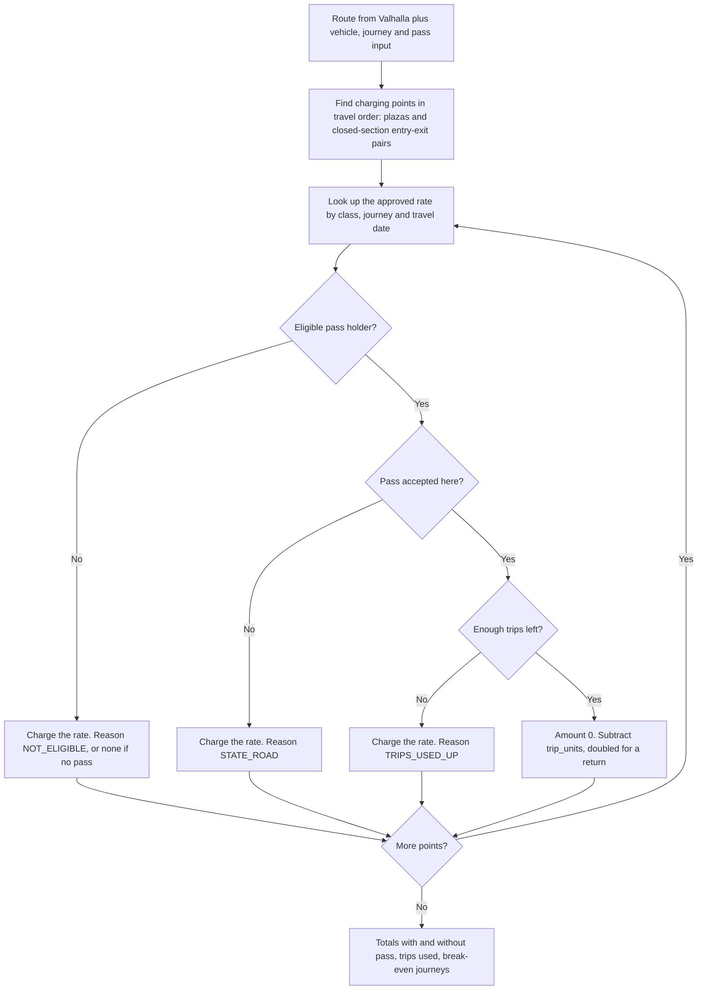
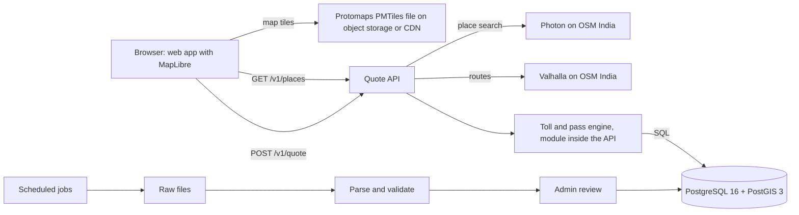
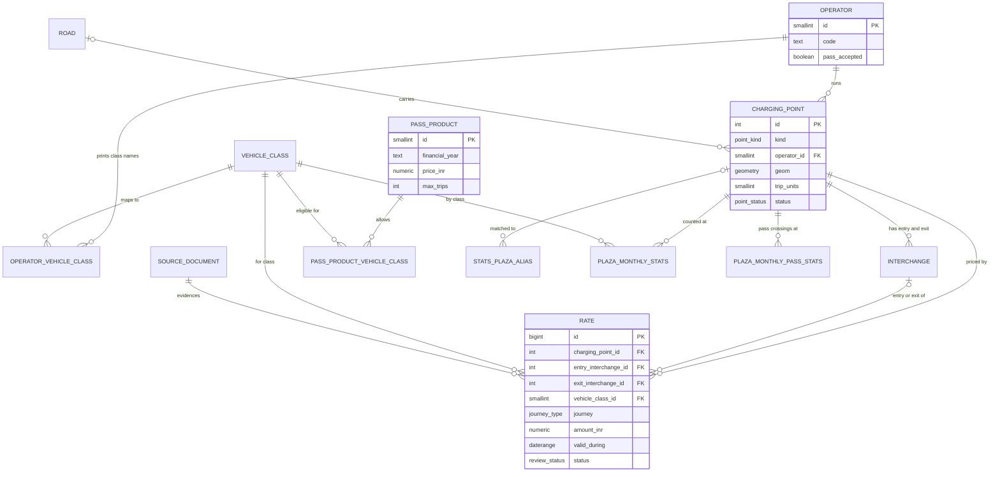

# India Toll Price MVP - LLM Build Context

Oct 31, 2026 · @Anikate Chaurasia

## How to use this document

You are building a web app that tells Indian road users the exact toll for a trip, whether their FASTag annual pass covers it, and a few facts about the road. This document is the full specification: read all of it before writing code, then build in the order given in "Build order".

Ground rules for the builder:

- **Toll amounts must be exact.** Every rupee comes from a rate row in the database. Never estimate, interpolate or invent a toll, and never ask a language model for one.
- **Rules are data, not code.** Pass acceptance, trip counting, pass price and eligible classes live in tables. A rule change must be a data update.
- **Free and open-source only.** Use the stack in "Architecture". Do not add paid APIs (Google Maps, Mappls, TollGuru) without being asked.
- **Store nothing about users.** No accounts, no trip history, no vehicle numbers.
- **When the spec is silent, choose the simplest option that keeps tolls exact**, write the decision in `DECISIONS.md`, and continue. Ask only when a choice would change a toll amount.

What is fixed: the domain rules, the database schema, the API contract and the stack. What is open: code structure inside each service, UI styling, and library choices within the stated stack.

Facts in this document were checked on 31 October 2026. Rates and pass rules change, usually on 1 April; the data pipeline, not the code, must absorb that.

## Product

The app answers one question well: how much toll will I pay on this trip? The user enters a start, a destination, a vehicle and pass status, and gets one screen with three answers.

1. **Toll price.** Total for the trip and a list of every toll point in travel order, with operator and amount.
2. **Annual pass usage.** Whether the FASTag annual pass applies, which points it covers, how many pass trips the journey uses, and why it does not apply at any uncovered point. Without a pass: what the trip would cost with one and how many such trips pay for the pass.
3. **Route insights.** Three or four plain facts from last year's public data, such as the busiest plaza on the route.

Up to three routes are offered: the usual route, the lowest-toll route, and a toll-free route if one exists.

| In scope | Out of scope (do not build) |
| --- | --- |
| All six vehicle classes | Live traffic and exact travel time (show an estimate only) |
| National highways (NH), national expressways (NE), state toll roads | Fuel cost and trip budgets |
| One way, and return within 24 hours | Local-resident and monthly plaza passes |
| FASTag annual pass eligibility, coverage, trips used, break-even | User accounts, saved trips, payments |
| Route facts from IHMCL monthly reports | Chat or voice interface |
| Web app, responsive for phones | Native mobile apps |

## Domain rules

These rules decide every amount the app shows. Implement them exactly; each is stored as data so it can change without a release.

### Charging points

A route pays tolls at **charging points** of two kinds:

- **Plaza (point-based, "open" tolling).** A fixed amount is paid each time the plaza is crossed. Most national highways work this way.
- **Closed section.** Paid by the pair of interchanges where the vehicle enters and exits, whatever gantries lie between. Most expressways work this way, e.g. the UP state expressways. Price comes from an entry-exit rate matrix.

Some plazas are now barrier-free (MLFF: FASTag readers and number-plate cameras on gantries). They are priced the same way; the `is_mlff` flag is for display only.

### Vehicle classes

| Code | Class | Annual pass possible? |
| --- | --- | --- |
| `CAR_JEEP_VAN` | Car / jeep / van / LMV | Yes, if non-commercial |
| `LCV` | LCV / LGV / minibus | No |
| `BUS_TRUCK_2AXLE` | Bus / truck (2 axle) | No |
| `AXLE_3` | 3-axle commercial vehicle | No |
| `AXLE_4_6` | HCM / EME / MAV (4 to 6 axle) | No |
| `AXLE_7_PLUS` | Oversized vehicle (7 or more axle) | No |

Each operator prints its own class names in its notices. Map them to these six through `operator_vehicle_class`; never show an operator's raw class name as a choice in the UI.

### Rates

- A rate depends on the charging point (or entry-exit pair), vehicle class, journey type and **travel date**.
- Journey types: `ONE_WAY`, and `RETURN_24H` (a discounted return fare when both legs are within 24 hours). If a point has no `RETURN_24H` rate, charge two `ONE_WAY` fares.
- NHAI revises rates every year, usually effective 1 April. Rates carry `effective_from` and `effective_to`, so a quote for a future date uses the rate in force on that date.
- Only rates with status `APPROVED` are ever used for a quote.
- Paying without a valid FASTag costs more (cash at double the fee). The MVP assumes FASTag and shows one line noting this; it does not compute non-FASTag amounts.

### FASTag annual pass

Facts as of FY 2026-27 (stored in `pass_product`, not in code):

- Price ₹3,075 for FY 2026-27 (launched at ₹3,000 on 15 August 2025).
- Valid for one year from activation or 200 trips, whichever comes first, then it reverts to a normal FASTag.
- Only non-commercial cars, jeeps and vans.
- Valid only at NH and NE fee plazas run by NHAI or MoRTH (about 1,150 plazas). Not valid on state-run roads: for example the Yamuna, Agra-Lucknow, Purvanchal, Bundelkhand and Ganga expressways, Samruddhi Mahamarg, Mumbai-Pune Expressway, Atal Setu and KMP Expressway. At those points the normal FASTag balance is charged.

Pass logic, applied to each charging point in travel order:

1. If the user has no active pass, or the vehicle is not a non-commercial `CAR_JEEP_VAN`: charge the rate. Reason `NOT_ELIGIBLE` (or no reason if there is no pass).
2. Else if the point's operator has `pass_accepted = false`: charge the rate. Reason `STATE_ROAD`.
3. Else if pass trips left are fewer than the trips this point needs: charge the rate. Reason `TRIPS_USED_UP`.
4. Else: amount ₹0, subtract the trips from trips left.

**Trip counting** (official NHAI rule): each crossing of a point-based plaza is one trip, and a return through the same plaza is two trips. One entry-exit pair on a closed section is one trip. Store this as `charging_point.trip_units` (1 by default) and multiply by 2 for `RETURN_24H` journeys.

If the user did not say how many trips are left, assume enough and show "assuming your pass has trips left".

**Break-even** (shown only when the user has no pass and the vehicle is eligible): saving per journey = toll without pass − toll with pass. Journeys to pay off = pass price ÷ saving, rounded up. If the saving is ₹0, say the pass does not help on this route.

The whole per-point logic, as one flow:



Eligible pass holder = active annual pass and a non-commercial `CAR_JEEP_VAN`. Pass accepted here = the point's operator has `pass_accepted = true`.

## Architecture and stack

One web app, one API service with the toll engine inside it, one database, three self-hosted open-source map services, and scheduled data jobs. Keep it this small.



| Component | Choice | Notes | Licence |
| --- | --- | --- | --- |
| Web app | TypeScript + React, built with Vite; MapLibre GL JS via react-map-gl | Static build; draws the route and toll points | MIT / BSD |
| Map tiles | Protomaps PMTiles extract of India | One file on object storage; do not use public OSM tile servers in production | BSD; map data ODbL |
| Place search | Photon, built from the OSM India extract | Search-as-you-type for towns and cities | Apache 2.0 |
| Routing | Valhalla, built from the OSM India extract (Geofabrik) | Use `auto` costing; `use_tolls` 0 to 1 for toll-avoiding and lowest-toll variants; `alternates` for the usual route | MIT |
| Quote API | Python 3.12 + FastAPI | Stateless; holds the toll and pass engine as a module | Own code |
| Database | PostgreSQL 16 + PostGIS 3 | Schema below; rates versioned by date | PostgreSQL / GPL |
| Jobs | Python: httpx or Playwright to fetch, pdfplumber or Camelot for PDF tables, rapidfuzz for name matching; run by cron or a scheduled CI workflow | Scrape, parse, validate, load | Own code |
| Admin review | A small password-protected page in the API | Approve or reject pending rates and plaza matches | Own code |
| Local dev | Docker Compose: api, db, valhalla, photon, web | One command brings everything up | n/a |
| Caching | None at first; in-process cache for Valhalla routes | Add Redis only when running more than one API server | n/a |
| Hosting | One server in an Indian cloud region (Mumbai, Hyderabad or Pune), Docker Compose, about 16 GB RAM | Valhalla and Photon for all of India need the memory; no Kubernetes for the MVP | n/a |
| Testing | pytest against a real PostGIS database in a container; Playwright for the browser | Never mock the database for toll tests | Apache 2.0 / MIT |
| Later, not in the MVP | Astro for pre-built popular route pages, reusing the React calculator | Only if search traffic becomes a goal; still static files, no Node server | MIT |

Attribution: show "© OpenStreetMap contributors" on the map, and credit IHMCL and data.gov.in under route facts.

Target: a quote returns in under 1.5 seconds at p95, most of it in Valhalla. Everything after routing is a few indexed SQL queries.

## Data sources and jobs

All data is free and public. None of it has an API, so each source gets its own job that writes raw files first, then parses, validates and loads them as `PENDING` for review.

| Data | Source | Job and schedule | Watch out for |
| --- | --- | --- | --- |
| Road network, places | [Geofabrik OSM India extract](https://download.geofabrik.de/asia/india.html) | `osm_refresh`: monthly; rebuild Valhalla tiles and Photon index | Large rebuild; run off-peak |
| NH and NE plazas, location, rates by class | [NHAI Toll Information System](https://tis.nhai.gov.in) | `tis_scrape`: weekly; daily from 20 March to 15 April | No API; respect the site's terms and rate-limit requests |
| Legal rate and effective date | Gazette fee notifications linked from TIS | `gazette_parse`: when TIS links a new notice | Scanned PDFs; extracted rates always need review |
| State expressway rates and entry-exit matrices | UPEIDA, YEIDA, MSRDC and other state authority sites | `state_rates`: monthly check, manual entry form | Start with UP, Maharashtra, Haryana, Gujarat |
| Annual pass price and rules | NHAI and [IHMCL](https://ihmcl.co.in) FAQs, PIB releases | Manual entry in admin page | Changes once a year at most |
| Plaza FASTag crossings and value by class; annual pass crossings | [IHMCL ETC transaction reports](https://ihmcl.co.in/etc-transaction-reports/) (monthly PDFs) | `ihmcl_stats`: monthly | PDF tables; plaza names differ from TIS |
| Older and state-level figures | [data.gov.in](https://data.gov.in) | Optional, as released | Attribution required |

Rules every job follows:

- Save the raw file and its SHA-256 in `source_document` before parsing. Skip a file whose checksum is already loaded.
- Load rates as `PENDING`. A rate goes to review when it is new, or differs from the current approved rate by more than 10%.
- When a new rate is approved, set the old rate's `effective_to` to the day before the new `effective_from` in the same transaction. The database rejects overlapping approved rates.
- A plaza that disappears from TIS is flagged for review, never deleted.
- Plaza name matching for IHMCL statistics: normalise names (case, punctuation, "toll plaza", "fee plaza"), fuzzy-match within the same state against `charging_point.name`, auto-accept above 0.9 similarity, send the rest to review. Store results in `stats_plaza_alias`.
- After loading monthly statistics, run `REFRESH MATERIALIZED VIEW plaza_fy_stats`.

## Database schema

Use this schema as is. It was loaded into PostgreSQL 16 + PostGIS 3.4 and tested with sample data: plazas found in travel order, a crossing road excluded, closed-section entry and exit found, the correct rate chosen either side of 1 April, and overlapping or half-filled rates rejected. Put it in the first migration; later changes go in new migrations.

Key ideas:

- `charging_point` covers both plazas and closed sections; `interchange` holds a closed section's entry and exit points.
- `rate` is versioned by date (`valid_during`) and reviewed (`status`). An exclusion constraint stops two approved rates overlapping.
- `operator.pass_accepted` and `charging_point.trip_units` drive the annual pass logic.
- `plaza_fy_stats` is the only statistics object a quote reads.
- Three SQL functions do the route matching and rate lookup used by the quote.

How the tables relate (key columns only; the SQL below has every column):



```sql
-- India Toll Price MVP - database schema (PostgreSQL 16 + PostGIS 3)
-- Toll price, annual pass coverage, route insights. Nothing about users is stored.

CREATE EXTENSION IF NOT EXISTS postgis;
CREATE EXTENSION IF NOT EXISTS btree_gist;   -- for non-overlapping rate periods

-- Enums
CREATE TYPE operator_level   AS ENUM ('CENTRAL', 'STATE', 'PRIVATE');
CREATE TYPE road_type        AS ENUM ('NH', 'NE', 'SH', 'STATE_EXPRESSWAY', 'BRIDGE', 'OTHER');
CREATE TYPE point_kind       AS ENUM ('PLAZA', 'CLOSED_SECTION');
CREATE TYPE point_status     AS ENUM ('ACTIVE', 'SUSPENDED', 'TOLL_FREE');
CREATE TYPE journey_type     AS ENUM ('ONE_WAY', 'RETURN_24H');
CREATE TYPE review_status    AS ENUM ('PENDING', 'APPROVED', 'REJECTED');
CREATE TYPE source_doc_type  AS ENUM ('TIS_PAGE', 'GAZETTE', 'STATE_SITE', 'IHMCL_REPORT', 'DATA_GOV_IN', 'MANUAL');

-- Provenance: every rate and statistic points to the document it came from
CREATE TABLE source_document (
    id            bigserial PRIMARY KEY,
    doc_type      source_doc_type NOT NULL,
    url           text            NOT NULL,
    fetched_at    timestamptz     NOT NULL DEFAULT now(),
    sha256        char(64)        NOT NULL,
    reviewed_by   text,
    reviewed_at   timestamptz,
    UNIQUE (url, sha256)
);

-- Who runs the road, and whether the FASTag annual pass is accepted there
CREATE TABLE operator (
    id             smallserial    PRIMARY KEY,
    code           text           NOT NULL UNIQUE,      -- 'NHAI', 'MORTH', 'UPEIDA', 'MSRDC' ...
    name           text           NOT NULL,
    level          operator_level NOT NULL,
    pass_accepted  boolean        NOT NULL DEFAULT false,
    website        text
);

-- Vehicle classes: one canonical list, plus each operator's own names
CREATE TABLE vehicle_class (
    id           smallint PRIMARY KEY,
    code         text     NOT NULL UNIQUE,
    name         text     NOT NULL,
    sort_order   smallint NOT NULL
);

CREATE TABLE operator_vehicle_class (
    operator_id          smallint NOT NULL REFERENCES operator(id),
    operator_class_name  text     NOT NULL,          -- as printed in that operator's notices
    vehicle_class_id     smallint NOT NULL REFERENCES vehicle_class(id),
    PRIMARY KEY (operator_id, operator_class_name)
);

-- Roads and charging points (a plaza, or a closed section priced entry-to-exit)
CREATE TABLE road (
    id         serial    PRIMARY KEY,
    ref        text,                     -- 'NH-48', 'Agra-Lucknow Expressway'
    name       text      NOT NULL,
    road_type  road_type NOT NULL
);

CREATE TABLE charging_point (
    id                  serial        PRIMARY KEY,
    kind                point_kind    NOT NULL,
    operator_id         smallint      NOT NULL REFERENCES operator(id),
    road_id             integer       REFERENCES road(id),
    name                text          NOT NULL,
    state               text          NOT NULL,
    tis_plaza_id        text          UNIQUE,          -- NHAI TIS id, when there is one
    geom                geometry(Point, 4326),         -- plazas only
    road_bearing_deg    numeric(5,1)  CHECK (road_bearing_deg >= 0 AND road_bearing_deg < 180),
    trip_units          smallint      NOT NULL DEFAULT 1,   -- annual-pass trips per passage
    is_mlff             boolean       NOT NULL DEFAULT false,
    status              point_status  NOT NULL DEFAULT 'ACTIVE',
    source_document_id  bigint        REFERENCES source_document(id),
    CONSTRAINT plaza_has_location CHECK (kind <> 'PLAZA' OR geom IS NOT NULL)
);
CREATE INDEX charging_point_geog_idx ON charging_point USING gist ((geom::geography));
CREATE INDEX charging_point_operator_idx ON charging_point (operator_id);

-- Entry and exit points of a closed section
CREATE TABLE interchange (
    id                 serial      PRIMARY KEY,
    charging_point_id  integer     NOT NULL REFERENCES charging_point(id) ON DELETE CASCADE,
    name               text        NOT NULL,
    chainage_km        numeric(7,3) NOT NULL,
    geom               geometry(Point, 4326) NOT NULL,
    can_enter          boolean     NOT NULL DEFAULT true,
    can_exit           boolean     NOT NULL DEFAULT true,
    UNIQUE (charging_point_id, name)
);
CREATE INDEX interchange_geog_idx ON interchange USING gist ((geom::geography));

-- Rates: versioned by date, reviewed before use.
-- Plaza rows: entry/exit interchange NULL. Closed-section rows: both set.
CREATE TABLE rate (
    id                    bigserial     PRIMARY KEY,
    charging_point_id     integer       NOT NULL REFERENCES charging_point(id),
    entry_interchange_id  integer       REFERENCES interchange(id),
    exit_interchange_id   integer       REFERENCES interchange(id),
    vehicle_class_id      smallint      NOT NULL REFERENCES vehicle_class(id),
    journey               journey_type  NOT NULL,
    amount_inr            numeric(10,2) NOT NULL CHECK (amount_inr >= 0),
    effective_from        date          NOT NULL,
    effective_to          date,                                   -- NULL = still in force
    valid_during          daterange     GENERATED ALWAYS AS (daterange(effective_from, effective_to, '[]')) STORED,
    status                review_status NOT NULL DEFAULT 'PENDING',
    source_document_id    bigint        NOT NULL REFERENCES source_document(id),
    CONSTRAINT od_pair_complete CHECK ((entry_interchange_id IS NULL) = (exit_interchange_id IS NULL)),
    CONSTRAINT period_order     CHECK (effective_to IS NULL OR effective_to >= effective_from),
    CONSTRAINT no_overlapping_approved_rates EXCLUDE USING gist (
        charging_point_id                    WITH =,
        (coalesce(entry_interchange_id, 0))  WITH =,
        (coalesce(exit_interchange_id, 0))   WITH =,
        vehicle_class_id                     WITH =,
        journey                              WITH =,
        valid_during                         WITH &&
    ) WHERE (status = 'APPROVED')
);
CREATE INDEX rate_lookup_idx ON rate (charging_point_id, vehicle_class_id, journey) WHERE status = 'APPROVED';

-- FASTag annual pass, per financial year
CREATE TABLE pass_product (
    id                       smallserial   PRIMARY KEY,
    code                     text          NOT NULL,          -- 'FASTAG_ANNUAL'
    financial_year           text          NOT NULL,          -- 'FY2026-27'
    price_inr                numeric(10,2) NOT NULL,
    max_trips                integer       NOT NULL,
    validity_days            integer       NOT NULL,
    requires_non_commercial  boolean       NOT NULL DEFAULT true,
    on_sale_from             date          NOT NULL,
    on_sale_to               date,
    source_document_id       bigint        REFERENCES source_document(id),
    UNIQUE (code, financial_year)
);

CREATE TABLE pass_product_vehicle_class (
    pass_product_id   smallint NOT NULL REFERENCES pass_product(id) ON DELETE CASCADE,
    vehicle_class_id  smallint NOT NULL REFERENCES vehicle_class(id),
    PRIMARY KEY (pass_product_id, vehicle_class_id)
);

-- Route insights: monthly figures from IHMCL reports, rolled up per FY
CREATE TABLE stats_plaza_alias (
    source_name        text    NOT NULL,     -- 'IHMCL'
    reported_name      text    NOT NULL,
    state              text    NOT NULL,
    charging_point_id  integer REFERENCES charging_point(id),   -- NULL until matched
    match_confidence   numeric(4,3),
    PRIMARY KEY (source_name, reported_name, state)
);

CREATE TABLE plaza_monthly_stats (
    charging_point_id   integer   NOT NULL REFERENCES charging_point(id),
    month               date      NOT NULL CHECK (extract(day FROM month) = 1),
    vehicle_class_id    smallint  NOT NULL REFERENCES vehicle_class(id),
    fastag_txn_count    bigint    NOT NULL CHECK (fastag_txn_count >= 0),
    fastag_value_inr    numeric(16,2) NOT NULL CHECK (fastag_value_inr >= 0),
    source_document_id  bigint    NOT NULL REFERENCES source_document(id),
    PRIMARY KEY (charging_point_id, month, vehicle_class_id)
);

CREATE TABLE plaza_monthly_pass_stats (
    charging_point_id     integer  NOT NULL REFERENCES charging_point(id),
    month                 date     NOT NULL CHECK (extract(day FROM month) = 1),
    annual_pass_txn_count bigint   NOT NULL CHECK (annual_pass_txn_count >= 0),
    source_document_id    bigint   NOT NULL REFERENCES source_document(id),
    PRIMARY KEY (charging_point_id, month)
);

-- Financial year label for a month: April-March
CREATE FUNCTION fy_label(d date) RETURNS text LANGUAGE sql IMMUTABLE AS $$
    SELECT 'FY' || (CASE WHEN extract(month FROM d) >= 4 THEN extract(year FROM d) ELSE extract(year FROM d) - 1 END)::int
           || '-' || lpad(((CASE WHEN extract(month FROM d) >= 4 THEN extract(year FROM d) ELSE extract(year FROM d) - 1 END)::int % 100 + 1)::text, 2, '0')
$$;

-- What the quote reads; refresh after each monthly load
CREATE MATERIALIZED VIEW plaza_fy_stats AS
WITH fastag AS (
    SELECT s.charging_point_id,
           fy_label(s.month)                                               AS financial_year,
           count(DISTINCT s.month)                                         AS months_reported,
           sum(s.fastag_txn_count)                                         AS fastag_txn_count,
           sum(s.fastag_value_inr)                                         AS fastag_value_inr,
           sum(s.fastag_txn_count) FILTER (WHERE vc.code = 'CAR_JEEP_VAN') AS car_txn_count
    FROM plaza_monthly_stats s
    JOIN vehicle_class vc ON vc.id = s.vehicle_class_id
    GROUP BY s.charging_point_id, fy_label(s.month)
),
pass AS (
    SELECT charging_point_id, fy_label(month) AS financial_year,
           sum(annual_pass_txn_count) AS annual_pass_txn_count
    FROM plaza_monthly_pass_stats
    GROUP BY charging_point_id, fy_label(month)
)
SELECT f.*, p.annual_pass_txn_count
FROM fastag f
LEFT JOIN pass p USING (charging_point_id, financial_year);

CREATE UNIQUE INDEX plaza_fy_stats_pk ON plaza_fy_stats (charging_point_id, financial_year);

-- 1. Plazas on a route, in travel order: within buffer_m of the route,
--    skipping plazas whose road runs more than 30 degrees off the route.
CREATE FUNCTION plazas_on_route(route_geojson text, buffer_m double precision DEFAULT 50)
RETURNS TABLE (charging_point_id integer, position_on_route double precision)
LANGUAGE sql STABLE AS $$
    WITH r AS (SELECT ST_SetSRID(ST_GeomFromGeoJSON(route_geojson), 4326) AS g),
    hits AS (
        SELECT cp.id, cp.road_bearing_deg,
               ST_LineLocatePoint(r.g, cp.geom) AS pos, r.g
        FROM charging_point cp, r
        WHERE cp.kind = 'PLAZA' AND cp.status = 'ACTIVE'
          AND ST_DWithin(cp.geom::geography, r.g::geography, buffer_m)
    )
    SELECT id, pos
    FROM hits
    WHERE road_bearing_deg IS NULL
       OR abs(mod((degrees(ST_Azimuth(
                ST_LineInterpolatePoint(g, greatest(pos - 0.0005, 0)),
                ST_LineInterpolatePoint(g, least(pos + 0.0005, 1))))::numeric
             - road_bearing_deg + 360), 180)) NOT BETWEEN 30 AND 150
    ORDER BY pos
$$;

-- 2. Closed sections on a route: first interchange entered, last one exited.
CREATE FUNCTION closed_sections_on_route(route_geojson text, buffer_m double precision DEFAULT 100)
RETURNS TABLE (charging_point_id integer, entry_interchange_id integer,
               exit_interchange_id integer, position_on_route double precision)
LANGUAGE sql STABLE AS $$
    WITH r AS (SELECT ST_SetSRID(ST_GeomFromGeoJSON(route_geojson), 4326) AS g),
    hits AS (
        SELECT i.charging_point_id, i.id, i.can_enter, i.can_exit,
               ST_LineLocatePoint(r.g, i.geom) AS pos
        FROM interchange i
        JOIN charging_point cp ON cp.id = i.charging_point_id AND cp.status = 'ACTIVE'
        CROSS JOIN r
        WHERE ST_DWithin(i.geom::geography, r.g::geography, buffer_m)
    ),
    ends AS (
        SELECT charging_point_id,
               (array_agg(id ORDER BY pos)      FILTER (WHERE can_enter))[1] AS entry_id,
               (array_agg(id ORDER BY pos DESC) FILTER (WHERE can_exit))[1]  AS exit_id,
               min(pos) AS pos
        FROM hits
        GROUP BY charging_point_id
    )
    SELECT charging_point_id, entry_id, exit_id, pos
    FROM ends
    WHERE entry_id IS NOT NULL AND exit_id IS NOT NULL AND entry_id <> exit_id
    ORDER BY pos
$$;

-- 3. Rate for one point on the travel date, with pass acceptance.
CREATE FUNCTION rate_for(p_point integer, p_entry integer, p_exit integer,
                         p_class smallint, p_journey journey_type, p_date date)
RETURNS TABLE (amount_inr numeric, pass_accepted boolean, trip_units smallint, rate_id bigint)
LANGUAGE sql STABLE AS $$
    SELECT r.amount_inr, o.pass_accepted, cp.trip_units, r.id
    FROM rate r
    JOIN charging_point cp ON cp.id = r.charging_point_id
    JOIN operator o        ON o.id  = cp.operator_id
    WHERE r.charging_point_id = p_point
      AND coalesce(r.entry_interchange_id, 0) = coalesce(p_entry, 0)
      AND coalesce(r.exit_interchange_id, 0)  = coalesce(p_exit, 0)
      AND r.vehicle_class_id = p_class
      AND r.journey = p_journey
      AND r.status = 'APPROVED'
      AND r.valid_during @> p_date
$$;

-- Reference data
INSERT INTO vehicle_class (id, code, name, sort_order) VALUES
 (1, 'CAR_JEEP_VAN',    'Car / jeep / van / LMV',             1),
 (2, 'LCV',             'LCV / LGV / minibus',                2),
 (3, 'BUS_TRUCK_2AXLE', 'Bus / truck (2 axle)',               3),
 (4, 'AXLE_3',          '3-axle commercial vehicle',          4),
 (5, 'AXLE_4_6',        'HCM / EME / MAV (4 to 6 axle)',      5),
 (6, 'AXLE_7_PLUS',     'Oversized vehicle (7 or more axle)', 6);

INSERT INTO operator (code, name, level, pass_accepted, website) VALUES
 ('NHAI',   'National Highways Authority of India',                       'CENTRAL', true,  'https://nhai.gov.in'),
 ('MORTH',  'Ministry of Road Transport and Highways',                    'CENTRAL', true,  'https://morth.nic.in'),
 ('UPEIDA', 'Uttar Pradesh Expressways Industrial Development Authority', 'STATE',   false, 'https://upeida.up.gov.in'),
 ('YEIDA',  'Yamuna Expressway Industrial Development Authority',         'STATE',   false, NULL),
 ('MSRDC',  'Maharashtra State Road Development Corporation',             'STATE',   false, 'https://msrdc.in');

INSERT INTO pass_product (code, financial_year, price_inr, max_trips, validity_days, requires_non_commercial, on_sale_from, on_sale_to) VALUES
 ('FASTAG_ANNUAL', 'FY2025-26', 3000, 200, 365, true, '2025-08-15', '2026-03-31'),
 ('FASTAG_ANNUAL', 'FY2026-27', 3075, 200, 365, true, '2026-04-01', '2027-03-31');

INSERT INTO pass_product_vehicle_class (pass_product_id, vehicle_class_id)
SELECT id, 1 FROM pass_product;
```

## Quote API and algorithm

Two public endpoints. All amounts are integer rupees in responses (round half up from `numeric`); all dates are `YYYY-MM-DD` in India Standard Time.

### GET /v1/places?q=lucknow&limit=5

Proxies Photon, restricted to India. Returns `[{ "id": "osm:N123", "name": "Lucknow", "detail": "Uttar Pradesh", "lat": 26.85, "lng": 80.95 }]`.

### POST /v1/quote

```json
{
  "from": { "lat": 26.85, "lng": 80.95 },
  "to":   { "lat": 28.61, "lng": 77.21 },
  "vehicle_class": "CAR_JEEP_VAN",
  "commercial": false,
  "journey": "ONE_WAY",
  "travel_date": "2026-11-02",
  "annual_pass": { "active": true, "trips_left": 140 }
}
```

`annual_pass` is optional; `trips_left` is optional. `travel_date` defaults to today. Validate every field; unknown fields are rejected with 400.

```json
{
  "rates_as_of": "2026-04-01",
  "pass_product": { "financial_year": "FY2026-27", "price_inr": 3075, "max_trips": 200 },
  "routes": [
    {
      "label": "USUAL",
      "distance_km": 512,
      "est_duration_min": 430,
      "geometry": { "type": "LineString", "coordinates": [[80.95, 26.85], [77.21, 28.61]] },
      "toll_with_pass_inr": 640,
      "toll_without_pass_inr": 1075,
      "complete": true,
      "pass": {
        "eligible": true,
        "points_covered": 3,
        "points_total": 4,
        "trips_used": 3,
        "trips_left_after": 137,
        "break_even_journeys": null
      },
      "points": [
        {
          "id": 101, "name": "Example plaza", "kind": "PLAZA",
          "operator": "NHAI", "road": "NH-27",
          "lat": 26.9, "lng": 80.1,
          "amount_without_pass_inr": 145, "amount_inr": 0,
          "pass_applied": true, "trips_used": 1, "reason": null
        },
        {
          "id": 205, "name": "Example expressway", "kind": "CLOSED_SECTION",
          "operator": "UPEIDA", "entry": "Interchange A", "exit": "Interchange B",
          "amount_without_pass_inr": 640, "amount_inr": 640,
          "pass_applied": false, "trips_used": 0, "reason": "STATE_ROAD"
        }
      ],
      "insights": [
        { "key": "busiest_plaza", "text": "…", "period": "FY2025-26", "source": "IHMCL" }
      ]
    }
  ]
}
```

The numbers above are placeholders that show the shape, not real rates.

Reason codes: `NOT_ELIGIBLE`, `STATE_ROAD`, `TRIPS_USED_UP`, `RATE_MISSING`. Route labels: `USUAL`, `LOWEST_TOLL`, `TOLL_FREE`. Errors use `{ "error": { "code": "...", "message": "..." } }` with codes `INVALID_INPUT` (400), `NO_ROUTE` (422), `UPSTREAM_UNAVAILABLE` (503).

### Quote algorithm

1. Ask Valhalla for routes with `auto` costing: the default request with `alternates: 1` (usual), one with `use_tolls: 0.1` (lowest toll), one with `use_tolls: 0` (toll-free). Decode each shape to GeoJSON.
2. For each route, call `plazas_on_route` and `closed_sections_on_route`. Merge both lists and sort by `position_on_route`.
3. For each point, call `rate_for` with the vehicle class, journey and travel date. For `RETURN_24H` with no return rate, use two `ONE_WAY` amounts. If no rate is found, add the point with `reason: RATE_MISSING`, `amount_inr: null`, and set the route's `complete` to false.
4. Apply the pass logic from "Domain rules" in travel order, counting `trip_units` (×2 for return journeys).
5. Sum `toll_without_pass_inr` and `toll_with_pass_inr`; compute `break_even_journeys` when the user has no pass and is eligible.
6. Add insights (next sections).
7. Drop a route whose set of charging points and total equal another route's; drop `TOLL_FREE` if it still has tolls. Return at most three routes, usual first.

Cache routes, not tolls: key Valhalla results on rounded start and end (3 decimals), costing options and date, for 24 hours. Always compute tolls fresh so an approved rate change applies at once.

## Web app

One page: a form on top (or left on desktop), the map beside it, the quote card below. Mobile first: most users will be on phones. Support English first; keep all copy in one strings file so Hindi can be added.

### Form

| Field | Control | Default |
| --- | --- | --- |
| From, To | Search-as-you-type using `/v1/places`; swap button | Empty |
| Vehicle | Six chips with plain names and small icons: Car / jeep / van, Mini bus or light goods, Bus or truck (2 axle), 3-axle truck, 4–6 axle truck, Larger vehicle | Car / jeep / van |
| Use | Private / Commercial (only shown for Car / jeep / van) | Private |
| Trip | One way / Return within 24 hours | One way |
| Annual pass | Toggle "I have a FASTag annual pass"; if on, optional "Trips left" number | Off |
| Date | Date picker, collapsed under "Travelling later?" | Today |

Button: **Get toll**. Put the form state in the URL query string so a quote can be shared and reloaded.

### Quote card (per route; tabs when there is more than one route)

- Header: From → To, then vehicle · trip · pass status in one line.
- Big number: what the user pays. If they have a pass, show "Without pass ₹X" beside it.
- Pass box, one of:
  - Covered: "Annual pass covers 3 of 4 toll points. Uses 3 trips; 137 left after this journey."
  - Partly covered: add "Not covered: \<point> (₹X), because state-run roads don't accept the pass."
  - Trips run out: "Your pass runs out of trips at \<point>; tolls after that are charged."
  - No pass, eligible: "With an annual pass you'd pay ₹X instead of ₹Y. It pays for itself after N trips like this." If no saving: "The annual pass doesn't help on this route."
  - Not eligible: "The annual pass is only for private cars, jeeps and vans."
- Point list in travel order: name, operator, road, amount, and a "Pass" tag where it applied.
- Route facts (next section).
- Footer: "Rates as of \<date>. Paying without a FASTag costs more. Always check the plaza's notice board."

### Map

Draw each route; the selected one is solid, others are grey. Mark toll points with a coin marker: filled for charged, outlined for covered by the pass. Tapping a marker scrolls the list to that point.

### States

- Loading: skeleton card; keep the form usable.
- `complete: false`: banner "We don't have rates for 1 toll point on this route yet, so the total may be low", and that point shows "Rate not available".
- No route: "We couldn't find a road route between these places."
- Error: "Something went wrong getting the toll. Try again." with a retry button.

Accessibility: all controls keyboard-usable with visible focus, colour contrast at WCAG AA, amounts read correctly by screen readers ("rupees 640"), respect reduced motion.

## Route insights

Show at most four plain facts per route, from the latest financial year with 12 reported months in `plaza_fy_stats` (fall back to the latest year with any data and say "partial year").

| Key | Text template | Computed from |
| --- | --- | --- |
| `toll_points` | "4 toll points over 410 km, about ₹2.6 per km." | The quote: point count; toll without pass ÷ route distance |
| `busiest_plaza` | "Busiest plaza on this route: \<name>, about 1.1 crore FASTag crossings in FY 2025-26." | Max `fastag_txn_count` among the route's points |
| `collection` | "Plazas on this route collected about ₹480 crore through FASTag in FY 2025-26." | Sum of `fastag_value_inr` over the route's points |
| `pass_share` | "About 1 in 5 car crossings at these NH plazas used the annual pass." | Sum `annual_pass_txn_count` ÷ sum `car_txn_count`, NH/NE points only |

Rules:

- Use Indian number words: lakh (100,000) and crore (10,000,000). Round to two significant figures.
- Show a fact only if at least half the route's points have data for it; otherwise leave it out. Never estimate a missing plaza.
- Every fact carries its period and source, shown in a small line: "FASTag data from IHMCL monthly reports, FY 2025-26."
- These are FASTag figures only: cash and exempt vehicles are not counted, and IHMCL notes its figures can change after reconciliation. Do not call them "total traffic".

## Repository, conventions and testing

One repository, laid out like this:

```
toll-price-mvp/
  README.md                 how to run locally in one command
  DECISIONS.md              choices made where this spec was silent
  docker-compose.yml        db, valhalla, photon, api, web
  db/
    migrations/001_schema.sql   the schema from this document
    seed/                   small sample data for dev and tests
  api/
    app/main.py             FastAPI app, routes /v1/places, /v1/quote, /admin
    app/engine/             route matching, rating, pass rules, totals (pure functions)
    app/insights.py
    app/clients/            valhalla.py, photon.py
    tests/
  jobs/
    tis_scrape.py  gazette_parse.py  state_rates.py  ihmcl_stats.py  osm_refresh.sh
    common/                 download, checksum, source_document, review queue
  web/
    src/                    form, map, quote card, strings.en.json
  golden/
    journeys.csv            hand-checked journeys and expected totals
```

Conventions:

- Money is `numeric` in the database and `Decimal` in Python; never floats. Round only when building the response.
- The pass engine is a pure function: (ordered points with rates, vehicle, journey, pass input) → (amounts, reasons, trips). No database or network calls inside it.
- Configuration comes from environment variables: `DATABASE_URL`, `VALHALLA_URL`, `PHOTON_URL`, `ADMIN_PASSWORD`.
- Log one structured line per quote: route count, point count, rate version, timings. Never log coordinates beyond 2 decimals.
- Set a polite user agent and a delay of at least 2 seconds between requests in scrapers.

Testing (all must pass in CI before merge):

- **Pass engine unit tests**, at least: no pass; commercial car; pass on all-NH route; mixed NH and state route; trips run out midway; return journey doubles trips; closed section counts one trip; zero saving gives no break-even.
- **Database tests** against the seed: the checks listed under "Database schema" (travel order, crossing road excluded, 1 April switch, overlap rejected).
- **Golden journeys**: `golden/journeys.csv` holds journeys with totals checked by hand against official notices (columns: from, to, vehicle\_class, journey, travel\_date, has\_pass, expected\_without\_pass\_inr, expected\_with\_pass\_inr). Start with 20, grow to a few hundred. Any mismatch fails the build and blocks rate approval.
- **API contract tests** for every error code.
- **Web**: one end-to-end test that fills the form, gets a quote and checks the total renders.

## Build order

Build in this order. Finish each step's acceptance checks before starting the next.

| Step | Build | Done when |
| --- | --- | --- |
| 1. Foundation | Docker Compose with PostGIS, Valhalla and Photon on an OSM extract (start with one state, e.g. Uttar Pradesh, for speed); schema migration; seed data | `docker compose up` works; schema loads; database tests pass |
| 2. Engine | Pass engine as pure functions; route matching via the SQL functions | All pass engine unit tests pass |
| 3. Quote API | `/v1/places`, `/v1/quote` with the usual route, NH plazas, car class, one way | A seeded journey returns the expected total and pass summary; contract tests pass |
| 4. Web app | Form, map, quote card with all pass box variants and states | End-to-end test passes; usable on a 360 px wide screen |
| 5. Real NH data | `tis_scrape` + admin review page; load all NH and NE plazas and car rates | 20 golden journeys match to the rupee |
| 6. All classes and returns | Rates for all six classes; `RETURN_24H` | Golden journeys cover every class and a return trip |
| 7. More routes | `LOWEST_TOLL` and `TOLL_FREE` routes, de-duplication | A journey with a toll-free option shows it |
| 8. State roads | Closed sections and entry-exit matrices for UP expressways first, then Maharashtra, Haryana, Gujarat | A mixed NH + UP expressway journey shows `STATE_ROAD` and the right totals |
| 9. Insights | `ihmcl_stats`, name matching, `plaza_fy_stats`, insight rules | Facts appear only with enough data and carry period and source |
| 10. All India | Full India OSM extract; deploy | p95 quote under 1.5 s on the deployed stack |

## Risks and things not to do

Do not:

- Hard-code any rate, pass price, trip limit or list of pass-excluded roads in application code.
- Publish scraped rates without review, or delete a plaza because a scrape missed it.
- Silently leave a toll point out of a total; mark it `RATE_MISSING` and show the banner.
- Add live traffic, fuel cost, accounts, a chatbot or paid map APIs in this MVP.
- Store user locations, vehicle numbers or trip history.
- Use public OSM tile or Nominatim servers for production traffic.

Known risks:

- **TIS has no API.** Page changes break the scraper. Alert when a run finds fewer than 95% of the previous run's plazas, and hold changes for review.
- **State roads are manual work.** Until a state road is curated, its points show "Rate not available" and the total is marked incomplete.
- **Plaza matching.** A plaza 60 to 100 m from the OSM road line may be missed at 50 m; if golden journeys miss a plaza, raise `buffer_m` for that plaza type rather than globally.
- **Statistics licence.** IHMCL publishes reports freely but without an open licence. Show derived figures with attribution; do not redistribute raw files.
- **Tolling is changing.** Barrier-free MLFF plazas are being rolled out and satellite tolling is planned. A future distance-based charge becomes a new `point_kind`; the rest of the engine stays.

Open questions to resolve before launch:

- Production hosting provider and budget.
- Whether to show Hindi at launch or after.
- Whether to ask NHAI or IHMCL for a data-sharing arrangement to replace scraping.

### Sources

- [NHAI Toll Information System](https://tis.nhai.gov.in)
- [IHMCL ETC transaction reports](https://ihmcl.co.in/etc-transaction-reports/)
- [FASTag annual pass FAQ and trip counting (Vikaspedia, from NHAI)](https://egovernance.vikaspedia.in/viewcontent/e-governance/digital-payment/fastag-annual-pass-user-guide-and-faqs?lgn=en)
- [Annual pass fee revision to ₹3,075 for FY 2026-27 (RTI Wiki summary of PIB release)](https://righttoinformation.wiki/_export/xhtml/fastag-annual-pass-3000-rupees-200-trips)
- [Roads where the annual pass is not valid (Digit)](https://www.godigit.com/guides/fastag-card/fastag-annual-pass-exclusions-and-eligible-highways)
