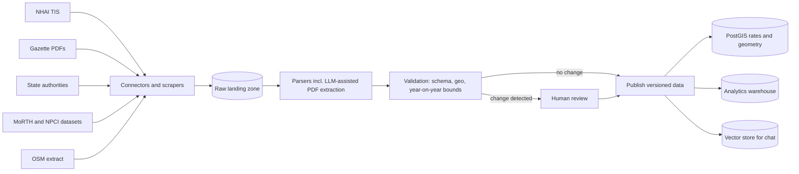
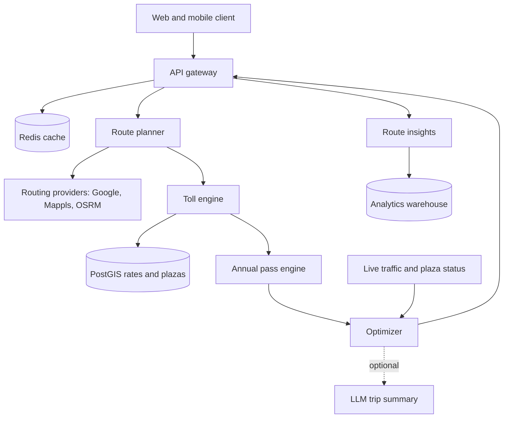
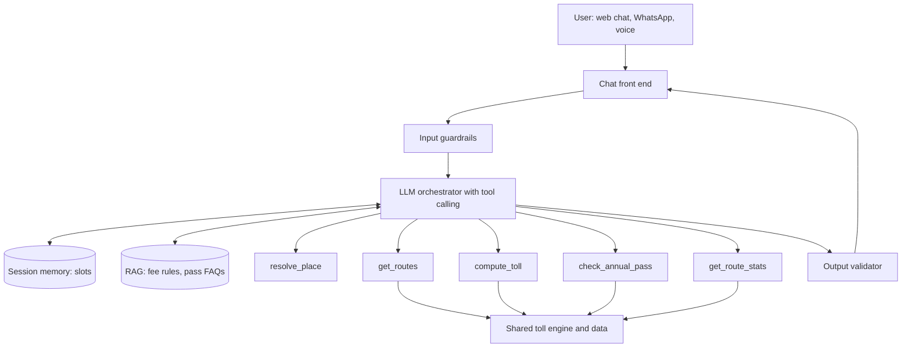

# A toll calculator for every Indian road

Design for a system that quotes the cheapest and fastest route between two places in India, prices every toll on it for any vehicle class, knows when the FASTag annual pass applies and when it doesn’t, and tells you what that road earned and carried last year.

It covers the data sources available today, a shared toll engine, and two ways to put it in front of people: a web app over APIs, and a conversational assistant over an LLM.

[Architecture diagrams (Lucid)](https://lucid.app/lucidchart/e10eb751-e925-46cc-8200-d142814032f8/view) [Data model (Lucid)](https://lucid.app/lucidchart/a41987dd-7b0e-4290-8b39-4b6da719c3ae/view) [Chat sequence (Lucid)](https://lucid.app/lucidchart/dabed8be-74a0-4ecb-adc2-34fde631dcd8/view)

NH

Toll calculator

0 km

Design as of 31 Oct 2026

1. [Requirements](#requirements)
2. [Toll rules that shape the design](#rules)
3. [Data sources](#data)
4. [Shared toll engine](#core)
5. [Approach A: web + APIs](#approach-a)
6. [Approach B: conversational LLM](#approach-b)
7. [Comparison](#compare)
8. [Recommendation and roadmap](#recommendation)
9. [Risks and open questions](#risks)
10. [Sources](#sources)

## Requirements

The five functional requirements map onto five capabilities. The table shows what each one actually demands of the system, which is where most of the design decisions come from.

| Requirement | What it really means | Design response |
| --- | --- | --- |
| 1. Optimised cost and time | Two objectives that conflict. Cheapest often means a slower NH; fastest often means a state expressway with its own tolls. | Fetch several candidate routes, price each fully, return a Pareto set: cheapest, fastest, balanced. |
| 2. Real-time | Toll rates change once a year; traffic, plaza queues and closures change by the minute. | Hot-reloadable versioned rate tables plus live traffic per request and a plaza-status stream. |
| 3. FASTag annual pass | Valid only on NHAI/MoRTH plazas, only for non-commercial cars, jeeps and vans, capped at 200 crossings. | Every plaza carries an authority flag; a pass engine zeroes eligible crossings and counts trips used. |
| 4. Route facts | Last-year collection and traffic need plaza-level, vehicle-class-level history. | Analytics warehouse fed from MoRTH plaza-wise FASTag datasets and other public releases, with coverage shown. |
| 5. By vehicle type | Rates differ by class; some APIs only price private cars. | Own rate tables for every class; external toll APIs used only as a cross-check. |

### Non-functional targets

Quote latency under 1.5 s at p95 for the web app (routing provider is most of it) and under 6 s for a full chat answer. Toll amounts must match the published notice to the rupee; any mismatch is a bug, not an approximation. Availability of 99.9% for the quote API. Every number shown carries a “rates as of” date and a source.

A rough load estimate: 200,000 daily users making two quotes each is about 400,000 quotes a day, roughly 5 per second on average and perhaps 50 per second on festival weekends. That is a small load for the toll engine; the real cost driver is the paid routing API, so caching routes matters more than scaling compute.

## Toll rules that shape the design

Indian tolling isn’t one system. It is a central network run under the National Highways Fee Rules, 2008, plus a patchwork of state authorities and concessionaires with their own rates and passes. The design has to encode these rules as data, because each of them changes on its own schedule.

### Vehicle classes

| Class | Covers | Annual pass? |
| --- | --- | --- |
| Car / jeep / van / LMV | Private and commercial light vehicles | Non-commercial only |
| LCV / LGV / minibus | Light commercial and goods vehicles | No |
| Bus / truck (2 axle) | Standard buses and trucks | No |
| 3-axle commercial | Three-axle trucks | No |
| HCM / EME / MAV (4–6 axle) | Heavy construction machinery, multi-axle vehicles | No |
| Oversized (7+ axle) | Oversized vehicles | No |

State expressways publish their own class lists, usually similar but not identical, so the model keeps a mapping from each authority’s class names to this canonical list.

### Open versus closed tolling

Most national highways are **open**: you pay a fixed amount at each plaza you pass. Many expressways are **closed**: you pay by entry and exit point, so the fee depends on the pair of interchanges, not on a single plaza. The toll engine needs both a per-plaza rate table and an origin–destination rate matrix per closed section.

### Journey types and payment mode

The same plaza can charge a single-journey fee, a discounted return fee within 24 hours, a monthly pass, or a local-resident concession. Paying without a valid FASTag costs more: double in cash, and a smaller multiplier via UPI under rules that took effect in 2025–26. NHAI rates are revised every year, typically from 1 April, indexed to wholesale prices; the April 2026 revision raised most rates by around 4–5%.

### The FASTag annual pass

The pass launched on 15 August 2025 at ₹3,000 and was revised to ₹3,075 for FY 2026–27 from 1 April 2026. It is valid for one year or 200 crossings, whichever comes first, at about 1,150 NH and NE fee plazas, and is open to non-commercial cars, jeeps and vans with a valid FASTag. Over 56 lakh vehicle owners had taken it by March 2026. When it runs out, the tag reverts to a normal FASTag; unused trips aren’t refunded.

**The most important edge case:** the pass doesn’t apply on state-run roads. Yamuna, Purvanchal, Bundelkhand, Agra–Lucknow, Ganga and other UP expressways, Samruddhi Mahamarg, Mumbai–Pune Expressway, Atal Setu and the KMP Expressway all charge the regular FASTag balance even when the pass is active. A Lucknow–Delhi trip via the Agra–Lucknow and Yamuna expressways can still cost a pass holder well over ₹1,000, while the NH route may cost nothing. That’s exactly the kind of answer the optimiser exists to produce.

### The tolling technology is changing underneath

India deferred a full switch to GNSS satellite tolling in 2025 and is rolling out barrier-less Multi-Lane Free Flow (MLFF) using FASTag readers and number-plate cameras on gantries instead. The first MLFF plaza went live at Choryasi on NH-48 in August 2025, and the Mundka–Bakkarwala plaza on UER-II followed in 2026. GNSS remains part of the long-term plan. The data model therefore treats a “charging point” as either a plaza, a gantry, or a distance-based segment, so the engine doesn’t need rewriting when pricing moves from points to kilometres.

## Data sources

There is no single official API that returns “all tolls on this route for this vehicle”. The system has to assemble that answer from six kinds of source. The table lists what’s available, how you get it, and what to watch for.

| Source | What it gives | Access | Freshness | Caveats |
| --- | --- | --- | --- | --- |
| Toll infrastructure and rates |  |  |  |  |
| [NHAI Toll Information System (TIS)](https://tis.nhai.gov.in) | NH plaza list, location, NH number, rates by class and journey type, local concessions, project details such as commercial operation date and capital cost | Public web portal and map data; no documented API. Open-source scrapers exist (e.g. [toll-plazas-india](https://github.com/ajitccdc/toll-plazas-india)) | Updated with notices; check monthly and every April | Scraping must respect the site’s terms; HTML can change without notice |
| Fee notifications and gazette PDFs | The legal rate for each plaza and the effective date of each revision | PDFs linked from TIS and project offices | Annual revision around 1 April plus ad hoc changes | Scanned and inconsistent tables; needs PDF extraction and human review |
| State authorities: UPEIDA, YEIDA, MSRDC, Haryana and others | State expressway rates, closed-system entry–exit matrices, state passes | Websites, PDFs, press releases | Irregular | The biggest coverage gap; expect manual curation per state |
| [OpenStreetMap](https://www.openstreetmap.org) | Road graph, `barrier=toll_booth` nodes, `toll=yes` ways, interchanges | Planet or India extracts (Geofabrik) | Daily | Community data; plaza positions need reconciling with TIS |
| Traffic and collection statistics |  |  |  |  |
| MoRTH plaza-wise FASTag datasets (on [data.gov.in](https://data.gov.in), compiled by [Dataful](https://dataful.in/datasets/19664/)) | Monthly FASTag transaction count and value by state and plaza, and by vehicle category; annual-pass transactions by plaza | CSV download | Monthly | FASTag only, so cash and exempt vehicles are missing; state expressways may be absent |
| [NPCI NETC statistics](https://www.npci.org.in/what-we-do/netc-fastag/netc-ecosystem-statistics) | National monthly FASTag volume and value, bank-wise volumes | Web tables | Monthly | National level only; useful for context lines, not route facts |
| Parliament answers and NHAI annual reports | Plaza-wise annual collections, total NH collections by year | PDFs (Lok Sabha and Rajya Sabha question archives) | Several times a year | Unstructured; parse once per release |
| TIS project data | Target daily traffic in PCU, capital cost, concession period | Same as TIS above | Rarely changes | Design targets, not actual traffic |
| Routing and real-time |  |  |  |  |
| [Google Routes API](https://developers.google.com/maps/documentation/routes/calculate_toll_fees) | Routes, ETA in traffic, alternatives; toll estimate with the `IN_FASTAG` pass via `extraComputations: TOLLS` | Paid API; toll requests billed at a higher SKU | Live | Toll estimate is for non-commercial vehicles only, so it can’t meet requirement 5 alone |
| Mappls (MapmyIndia) APIs | India-native routing, geocoding, Mappls PIN; the consumer app already shows NHAI annual-pass savings built with NHAI | Paid API | Live | Check which toll fields the developer API exposes before relying on it |
| [TollGuru API](https://tollguru.com/toll-api-docs) (MapUp) | Toll cost for a route or polyline across many vehicle types, including India | Paid API | Provider-maintained | Third-party data; useful as a cross-check or a fast start |
| Self-hosted OSRM, Valhalla or GraphHopper on OSM | Unlimited routing with custom costs, e.g. “avoid state expressways” | Run your own | As fresh as your OSM import | No live traffic unless you add a feed |
| HERE, TomTom, Ola Maps | Alternative traffic and routing feeds | Paid APIs | Live | Coverage varies off the main corridors |
| Vehicle, pass and running cost |  |  |  |  |
| User input, with optional VAHAN lookup | Vehicle class and whether it is commercial | Ask the user; VAHAN only through an authorised partner, with consent | Per request | Registration data is personal; don’t store it |
| Annual pass status | Active or not, trips left, expiry | User input (no public API for third parties); Rajmargyatra app is the official place to check | Per request | Trips left is the user’s estimate; show it as an assumption |
| Fuel prices | Petrol, diesel and CNG prices by city | Oil marketing company price pages | Daily | Only needed for total trip cost |

### How the data gets in

Every source flows through the same pipeline so that each rate in the database can be traced back to a document, a fetch time and a reviewer.



Validation is where the April revision earns its keep: a new rate more than about 10% away from last year’s, a plaza that moved more than 200 m, or a class that disappeared goes to a review queue instead of production. Rates are stored with `effective_from` and `effective_to`, so a quote for a trip next week uses the rate that will apply next week. The full schema is in the [Lucid data model](https://lucid.app/lucidchart/a41987dd-7b0e-4290-8b39-4b6da719c3ae/view).

## Shared toll engine

Both approaches need the same thing underneath: a deterministic engine that turns a route and a vehicle into a rupee amount. Build this once and treat it as the product; the web app and the chat assistant are two front doors to it.

#### Matching a route to charging points

Take the route polyline from the routing provider. Find every plaza within about 50 m of the line using a PostGIS spatial index, then drop any whose carriageway bearing doesn’t match the direction of travel, which stops a plaza on the opposite side of a divided road being counted. For closed sections, find the first interchange where the route joins and the last where it leaves, then look up that pair in the entry–exit matrix. The whole index is a few thousand points, so it can also live in memory for speed.

#### Pricing each point

For each matched point, pick the rate row for the vehicle class, journey type and travel date. If the plaza is run by NHAI or MoRTH and the user has an active pass with trips left, set the amount to zero and count one trip. Otherwise charge the rate, then apply the non-FASTag multiplier if the user isn’t paying by FASTag. The flowchart is on page 4 of the [architecture document](https://lucid.app/lucidchart/e10eb751-e925-46cc-8200-d142814032f8/view).

#### Optimising cost and time together

Routing APIs return two or three alternatives, which isn’t enough to find the cheap option. Ask for more variants: the provider’s default, an avoid-tolls route, and from a self-hosted router a route that avoids state expressways. Score every candidate with a generalised cost:

```
cost = toll_payable + fuel_cost + value_of_time × duration + pass_shadow_price × pass_trips_used
```

The last term is the subtle one. An annual-pass crossing isn’t really free: each of the 200 trips is worth about ₹15 (₹3,075 ÷ 200) if the user will run out before the year ends, and close to nothing if they won’t. Asking “how many trips do you expect to use this year?” lets the optimiser price that correctly. Return the routes that aren’t beaten on both money and time, labelled cheapest, fastest and balanced, with a plaza-by-plaza breakdown for each.

#### What “real-time” means here

Three different speeds. Rates are effectively yearly, so they are cached and hot-reloaded when a new version is published. Traffic and ETA are fetched live for each quote. Plaza status, such as queue length, suspensions or a toll-free window on a new expressway, arrives as events on a stream and adjusts quotes as they’re computed.

## Approach A: web app over APIs

A form-based website and mobile app. The user picks origin, destination, vehicle class, pass status and journey type; the backend returns ranked routes. An LLM is optional and sits at the edges: extracting rates from PDFs during ingestion, and writing a short plain-language summary of numbers the engine has already computed.



### API contract

```
POST /v1/quotes
{
  "origin":      { "query": "Lucknow" },
  "destination": { "query": "New Delhi" },
  "vehicle":     { "class": "CAR_JEEP_VAN", "commercial": false, "fuel": "PETROL" },
  "journey":     "SINGLE",                // SINGLE | RETURN_24H
  "payment":     "FASTAG",                // FASTAG | UPI | CASH
  "annual_pass": { "active": true, "trips_left": 120, "expected_trips_this_year": 150 },
  "depart_at":   "2026-11-02T06:00:00+05:30",
  "value_of_time_inr_per_hour": 200
}

200 OK
{
  "rate_version": "FY2026-27 @ 2026-10-28",
  "quotes": [
    {
      "label": "CHEAPEST",
      "distance_km": 0, "duration_min": 0,
      "toll_payable_inr": 0, "toll_without_pass_inr": 0, "pass_trips_used": 0,
      "fuel_cost_inr": 0,
      "points": [
        { "name": "…", "authority": "NHAI", "pass_applied": true,  "amount_inr": 0 },
        { "name": "…", "authority": "UPEIDA", "pass_applied": false, "amount_inr": 0 }
      ]
    },
    { "label": "FASTEST",  "…": "…" },
    { "label": "BALANCED", "…": "…" }
  ],
  "insights": {
    "period": "FY2025-26",
    "fastag_transactions": 0, "fastag_value_inr": 0,
    "coverage_note": "FASTag data only; state expressway plazas not in source",
    "sources": ["https://…"]
  }
}
```

Numbers in the example are placeholders; the shape is what matters. Every quote carries the rate version so support can reproduce any answer later.

### Caching and cost control

Cache routes on a key of origin cell, destination cell (an H3 hexagon at resolution 8 covers about 0.7 km²), 15-minute departure bucket and vehicle profile. Popular corridors such as Delhi–Jaipur or Mumbai–Pune will hit the cache most of the time. Toll pricing is cheap enough to recompute every time, which also means a rate change takes effect instantly without cache invalidation. Use the paid routing API for traffic-aware ETAs and the self-hosted router for extra toll-avoiding alternatives.

#### Strengths

- Every number is computed, traceable and testable.
- Fast and cheap per query.
- Easy to embed as an API for fleets and travel apps.
- Works well on low bandwidth.

#### Weaknesses

- Users must know their vehicle class and fill a form.
- Follow-up questions (“what if I come back tomorrow?”) mean re-entering everything.
- Rules and exceptions have to be explained in static help text.

## Approach B: conversational assistant over an LLM

The user types or speaks, in English, Hindi or Hinglish: “Lucknow se Delhi, car, mere paas annual pass hai.” The assistant asks only for what’s missing, computes the answer, and explains it in plain language, including why the pass doesn’t cover part of the route.

### Should the LLM be trained on toll data?

This is the key decision for this approach, and the honest answer is no, not for the numbers. There are three ways to give an LLM toll knowledge, and they suit different jobs:

| Technique | Good for | Bad for | Verdict |
| --- | --- | --- | --- |
| Fine-tuning or training on toll data | Tone, Hinglish place names, reliably calling the right tool, asking the right follow-up question | Rates (stale every April), plaza additions, route geometry, arithmetic across 10–15 plazas; errors look confident | Not for facts |
| Retrieval (RAG) over rule documents | Explaining rules: pass eligibility, exclusions, return-journey discounts, citing the source | Computing a route total | Use for rules |
| Tool calling into the toll engine | Every number: routes, tolls, pass usage, statistics | Nothing it’s asked to do; it needs the engine to exist | Use for numbers |

So Approach B is not a separate brain that knows Indian tolls. It is a language layer that understands the question, calls the same engine as Approach A, and explains the result. A small fine-tune can come later to make tool calls and Hinglish handling more reliable, once there are real conversation logs to learn from.



### Tools the model can call

```
resolve_place(text, near?)                       → { place_id, name, lat, lng, confidence }
get_routes(origin_id, destination_id, depart_at,
           variants=["DEFAULT","AVOID_TOLLS","AVOID_STATE_EXPWY"])
                                                 → [{ route_id, distance_km, eta_min }]
compute_toll(route_id, vehicle_class, commercial,
             journey, payment)                   → { total_inr, points:[…], rate_version }
check_annual_pass(points, trips_left)            → { covered_points, charged_points, trips_used }
get_route_stats(point_ids, period)               → { transactions, value_inr, by_class:[…], coverage, sources }
```

### Conversation design

**Slot filling.** Origin, destination and vehicle class are required; pass status, trips left, return trip, departure time and commercial use are optional with stated defaults. Ask one question at a time and offer quick-reply chips (“Car”, “Bus”, “Truck, 2 axle”) so nobody has to know the official class name.

**Grounding.** An output validator checks that every rupee amount, distance and count in the reply appears in a tool result from this turn. If not, the reply is regenerated or replaced with the structured card. Every answer ends with the rate version date.

**Languages and channels.** Web chat first, then WhatsApp Business, then voice. For Indian-language speech, Bhashini (the government language platform) or a commercial ASR can sit in front of the chat layer.

**Evaluation.** Keep a golden set of a few hundred origin–destination pairs across all vehicle classes, with hand-checked totals from official notices. Run it on every rate publish and every prompt or model change. Track tool-call accuracy and the number of clarifying questions per answer separately.

The full message flow, including the clarifying question and the parallel pricing of routes, is in the [Lucid sequence diagram](https://lucid.app/lucidchart/dabed8be-74a0-4ecb-adc2-34fde631dcd8/view).

#### Strengths

- Handles vague input and follow-ups naturally.
- Explains exceptions such as pass exclusions in context.
- Reaches people in their own language and on WhatsApp.

#### Weaknesses

- Slower (two to four model calls) and costlier per answer.
- Needs guardrails and an evaluation harness to be trustworthy.
- Harder to compare routes side by side in pure text; still needs a card UI.

## Comparison

| Dimension | A: web + APIs | B: conversational LLM |
| --- | --- | --- |
| Accuracy of amounts | Exact, from rate tables | Exact only if numbers come from tools and are validated |
| Handling unclear input | Form validation; user must choose | Asks clarifying questions |
| Latency | About 1 s | About 3–6 s, streamed |
| Cost per query | Routing API plus small compute | Same, plus model tokens |
| Build effort | Engine plus UI | Engine plus orchestration, guardrails, evaluation |
| Keeping data current | Publish new rate version | Same; nothing to retrain if tools are used |
| Explaining rules | Static help text | Contextual, with citations |
| Languages and channels | Translated UI | Native multilingual, WhatsApp, voice |
| Best for | Planners, fleets, integrations | Casual travellers, first-time pass users |

## Recommendation and roadmap

Build the shared engine first and ship Approach A as its first client. Add Approach B as a second client over the same API rather than as a separately trained model. That keeps one source of truth for every rupee, and lets the chat assistant improve independently without risking the numbers.

**Phase 1**NH and NE open plazas, car class, FASTag annual pass, web app. Data from TIS and gazette notices; routing from one paid provider.

**Phase 2**All vehicle classes, state expressways with closed-system matrices, route facts from MoRTH plaza datasets, public quote API.

**Phase 3**Conversational assistant on web and WhatsApp, live plaza status, return-journey and monthly-pass optimisation.

**Phase 4**Distance-based charging for MLFF and GNSS corridors, voice in Indian languages, fleet trip reconciliation from GPS traces.

## Risks and open questions

**No official rate API.** Everything rests on scraping portals and parsing PDFs. Talk to NHAI or IHMCL about a data-sharing arrangement early; until then, keep the review queue staffed around every April revision.

**State coverage.** Each state is its own project. Start with the corridors that carry most traffic and show users clearly when a section is estimated rather than confirmed.

**Annual-pass trip counting.** How a crossing is counted can differ between single plazas and closed sections. Encode the counting rule per charging point as data so it can be corrected without a deploy.

**Statistics are partial.** Plaza datasets cover FASTag transactions only. Label route facts with their coverage instead of presenting them as total traffic.

**Licensing.** Check the terms of Google, Mappls and TollGuru before caching or storing their outputs; some restrict storing route geometry or toll results.

**Personal data.** Don’t store registration numbers or exact trip histories by default. If the pass tracker remembers trips, make it opt-in.

## Sources

- NHAI Toll Information System and user manual: [tis.nhai.gov.in](https://tis.nhai.gov.in)
- FASTag annual pass rules and FY 2026–27 fee: NHAI/PIB release of 15 March 2026, summarised at [RTI Wiki](https://righttoinformation.wiki/_export/xhtml/fastag-annual-pass-3000-rupees-200-trips) and [Vikaspedia](https://egovernance.vikaspedia.in/viewcontent/e-governance/citizen-services/fastag-for-electronic-toll-collection?lgn=en)
- Pass exclusions on state roads: [Digit guide](https://www.godigit.com/guides/fastag-card/fastag-annual-pass-exclusions-and-eligible-highways), [Ganga Expressway coverage](https://theaarchnews.com/infrastructure-news/ganga-expressway-toll-rates-pass-details-2026/)
- Google Routes API toll calculation and `IN_FASTAG`: [developers.google.com](https://developers.google.com/maps/documentation/routes/calculate_toll_fees)
- MoRTH plaza-wise FASTag datasets: [Dataful 19664](https://dataful.in/datasets/19664/); NPCI NETC statistics: [npci.org.in](https://www.npci.org.in/what-we-do/netc-fastag/netc-ecosystem-statistics)
- MLFF and GNSS status: [Steer](https://www.steergroup.com/insights/news/fastag-free-flow-how-tolling-changing-indias-highways), [Drishti IAS](https://www.drishtiias.com/daily-updates/daily-news-analysis/india-defers-gnss-based-toll-collection/print_manually)
- Toll rate revision and payment rules overview: [TollGuru India guide](https://tollguru.mapup.ai/india-toll)

Rates, pass prices and exclusions change; verify against NHAI and state authority notices before relying on any figure in production.