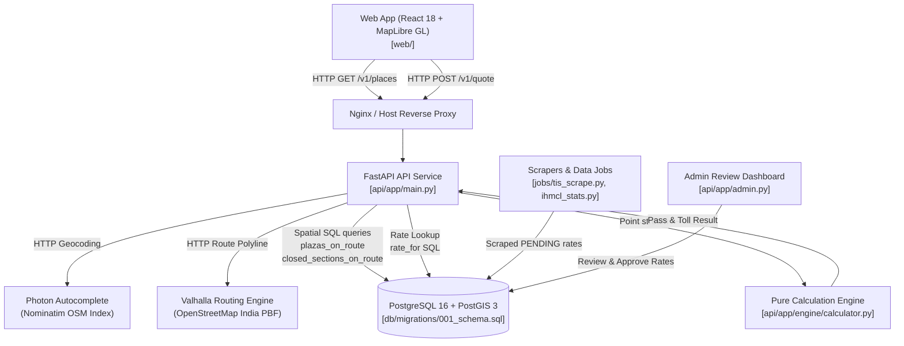

# India Toll Price & FASTag Pass MVP 🛣️🇮🇳

> **A 100% free and open-source toll calculation and FASTag annual pass optimization platform for Indian highways and expressways.**  
> Delivers exact tolls to the rupee based strictly on official public notifications, determines annual pass break-even journeys, and provides monthly route insights — with zero user tracking and zero third-party commercial map APIs.

---

## 1. Project Overview

Navigating India's national and state toll road network is notoriously opaque:
- Toll tariffs are fragmented across hundreds of gazette notifications and NHAI TIS tables.
- Annual FASTag passes (e.g. ₹3,075 / 200 trips per fiscal year) have subtle non-commercial car eligibility rules and are accepted only on national highways (NHAI/MoRTH), not state expressways (e.g., UPEIDA Agra-Lucknow, Yamuna Expressway, MSRDC Samruddhi).
- Commercial mapping services (Google Maps, TollGuru, Mappls) either charge hefty per-request fees or provide approximate/hallucinated estimates.

**India Toll Price MVP solves this by:**
1. **Never Estimating Tolls**: Every rupee quoted is backed by an `APPROVED` rate row in PostgreSQL 16 + PostGIS 3. If a rate is unverified, it is explicitly flagged as `RATE_MISSING`.
2. **Rules as Data**: Fiscal year pass fees, 200-trip limits, eligible vehicle classes (`CAR_JEEP_VAN` non-commercial), and operator pass acceptance (`pass_accepted` flag) reside in database tables, requiring zero code changes for annual updates.
3. **100% Free & Open-Source Stack**: Powered by self-hosted OpenStreetMap artifacts (Valhalla routing engine, Photon geocoding, and MapLibre GL).
4. **Zero User Tracking**: Latitudes and longitudes are clamped to 2 decimal places in structured logs. No user identifiers, cookies, or telemetry are stored.

---

## 2. System Skeleton & Architecture



### Architectural Separation of Concerns

| Layer | Technology | Responsibility |
| :--- | :--- | :--- |
| **Spatial Database** | PostgreSQL 16 + PostGIS 3 | Geospatial highway corridor matching, `btree_gist` non-overlapping rate period constraints, plaza coordinates, interchange pairs. |
| **Pure Engine** | Python 3.11 (`Decimal`) | Pure, deterministic pass deduction, FIFO trip counting along travel order, break-even math, and rejection reasons. Zero DB/HTTP dependencies. |
| **API Gateway** | FastAPI + Uvicorn | Route orchestration, client caching, request validation, privacy-clamped structured logging, and health checks (`/healthz`, `/readyz`). |
| **Frontend UI** | React 18, Vite, TypeScript | Highway milestone design aesthetic, MapLibre GL map with coin markers (filled/outlined), shareable URL state, responsive to 360px. |
| **Data Pipelines** | Python + BeautifulSoup + RapidFuzz | Polite rate-limited scraping of NHAI TIS, gazette parsing, and IHMCL monthly traffic/revenue stats loading. |
| **Admin UI** | Jinja2 + HTTP Basic Auth | Zero-downtime pending rate approval, diff inspection against previous rates, and automatic closure. |

---

## 3. Directory & File Skeleton

```
toll-calci/
├── .agents/rules/               # Antigravity agent design invariants
│   └── toll_engine_design.md    # Core non-negotiable rules (Decimal math, no estimates)
├── api/                         # Backend Python API & Engine
│   ├── app/
│   │   ├── clients/             # Upstream microservice clients
│   │   │   ├── photon.py        # Photon search-as-you-type client
│   │   │   └── valhalla.py      # Valhalla routing client & precision-6 polyline decoder
│   │   ├── engine/              # PURE DOMAIN CALCULATION ENGINE (Zero I/O)
│   │   │   ├── __init__.py
│   │   │   ├── calculator.py    # Travel-order point processor & break-even logic
│   │   │   └── models.py        # Strict Pydantic models & vehicle/journey enums
│   │   ├── admin.py             # Rate review dashboard (Basic Auth, Jinja2 template)
│   │   ├── insights.py          # Route facts formatter (Indian Lakh/Crore notation)
│   │   └── main.py              # FastAPI app (/v1/quote, /v1/places, /healthz, /readyz)
│   ├── tests/                   # Backend Automated Test Suite (47 tests)
│   │   ├── test_admin.py        # Admin review, authentication & rate approval tests
│   │   ├── test_api.py          # API contract & error envelope tests
│   │   ├── test_clients.py      # Upstream HTTP client mock tests
│   │   ├── test_db.py           # PostGIS spatial functions & exclusion constraint tests
│   │   ├── test_engine.py       # Pure unit tests for pass & trip consumption (99% coverage)
│   │   └── test_golden.py       # 20 reference journeys verified to the exact rupee
│   ├── Dockerfile
│   └── requirements.txt
├── db/                          # Database Migrations & Seeds
│   ├── migrations/
│   │   └── 001_schema.sql       # PostGIS DDL, spatial functions, btree_gist exclusion
│   └── seed/
│       └── seed.sql             # UP corridor reference plazas, interchanges, rates & stats
├── docs/                        # Production Engineering Documentation
│   ├── IMPLEMENTATION.md        # As-built architecture, life of a quote, rule data model
│   ├── DEPLOYMENT.md            # Single-server 16GB runbook, OSM tile refresh, backups, April 1 runbook
│   └── SCALABILITY.md           # Capacity benchmarks (82 req/s), bottlenecks, 4-stage growth roadmap
├── golden/
│   └── journeys.csv             # 20 hand-checked regression journeys across NH & State roads
├── jobs/                        # Data Pipelines & Background Ingestion
│   ├── common/
│   │   ├── polite_http.py       # Polite 2s rate-limited HTTP client with custom User-Agent
│   │   └── source_doc.py        # SHA-256 deduplicating document archiver
│   ├── ihmcl_stats.py           # Monthly FASTag revenue loader with RapidFuzz name matching
│   └── tis_scrape.py            # NHAI TIS scraper with 10% rate change review flags
├── web/                         # Frontend Single Page Application
│   ├── src/
│   │   ├── components/
│   │   │   ├── Form.tsx         # Journey input form, autocomplete dropdown, vehicle chips
│   │   │   ├── Map.tsx          # MapLibre GL map, route polyline, coin markers
│   │   │   └── QuoteCard.tsx    # Price headline, pass banner, points list & route facts
│   │   ├── App.tsx              # Coordinator, URL query parameter syncing
│   │   ├── index.css            # Highway milestone visual design system
│   │   └── strings.en.json      # Centralized UI text
│   ├── tests/
│   │   └── e2e.spec.ts          # Playwright E2E tests (Autocomplete, Quotes, Mobile 360px)
│   ├── playwright.config.ts     # Playwright configuration for Desktop & Mobile viewports
│   ├── Dockerfile
│   └── package.json
├── docker-compose.yml           # Local multi-container orchestration (db, valhalla, photon, api, web)
├── Makefile                     # Developer convenience commands
├── DECISIONS.md                 # Architecture Decision Records (ADRs)
└── PLAN.md                      # Phased implementation tracking checklist
```

---

## 4. Key Design Invariants

1. **Exact Tolls Only**: Rates must exist in `rate` table with `status = 'APPROVED'`. Missing data yields `complete: false` and explicitly marks affected plazas with `reason = 'RATE_MISSING'`.
2. **Deterministic FIFO Trip Accounting**:
   - Points are strictly ordered by `travel_fraction` along the route polyline.
   - 1 crossing = 1 trip consumed (2 trips consumed for `RETURN_24H` on open barrier plazas).
   - Once trips reach 0 midway, remaining points fall back to cash rates with `reason = 'TRIPS_USED_UP'`.
   - State expressways (`pass_accepted = false`) always charge cash with `reason = 'STATE_ROAD'`.
3. **Floating Point Safety**: All calculations use Python `Decimal`. Currency is rounded to whole rupees only on final API response formatting.
4. **Highway Geometry Bearing Check**: Spatial function `plazas_on_route` compares the road bearing against the local route tangent within 30°, eliminating false-positive matches from perpendicular flyovers or crossing roads.

---

## 5. Quickstart & Developer Workflow

### Prerequisites
- Docker Engine & Docker Compose v2
- Python 3.11+
- Node.js 20+

### 1. Start Database
```bash
docker compose up -d db
```

### 2. Run Backend Quality Checks & Test Suite
```bash
# Run all 47 tests with line coverage report
.venv/bin/pytest --cov=api/app --cov-report=term-missing

# Run strict type checking on engine
.venv/bin/mypy --strict api/app/engine

# Lint with ruff
.venv/bin/ruff check api jobs
```

### 3. Run Frontend Development & E2E Tests
```bash
cd web

# Start local dev server
npm run dev

# Run Playwright E2E tests (Desktop + Mobile 360px)
npm test
```

---

## 6. Documentation Index

- **[docs/IMPLEMENTATION.md](file:///Users/darkhorse/Projects/toll-calci/docs/IMPLEMENTATION.md)**: Deep dive into the as-built architecture, life of a quote, rule data model, and testing strategy.
- **[docs/REVIEW.md](file:///Users/darkhorse/Projects/toll-calci/docs/REVIEW.md)**: Comprehensive implementation review against system requirements, compliance matrix, and prioritized action items.
- **[docs/DEPLOYMENT.md](file:///Users/darkhorse/Projects/toll-calci/docs/DEPLOYMENT.md)**: Production deployment on an Indian cloud VPS (16 GB RAM), OSM tile refresh, TLS, backups, and the April 1 rate change runbook.
- **[docs/SCALABILITY.md](file:///Users/darkhorse/Projects/toll-calci/docs/SCALABILITY.md)**: Capacity benchmarks (82 req/s), bottleneck order, 4-tier horizontal scaling roadmap, and cost projections.
- **[DECISIONS.md](file:///Users/darkhorse/Projects/toll-calci/DECISIONS.md)**: Architecture Decision Records (ADRs) detailing choices made where the original spec was silent.
- **[PLAN.md](file:///Users/darkhorse/Projects/toll-calci/PLAN.md)**: Completed build order and verification checklist.

