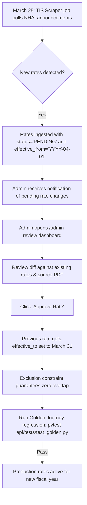

# India Toll Calculator MVP — Production Deployment Runbook

This guide describes how to provision, configure, and maintain the India Toll Calculator stack on a single cloud server located in an Indian cloud region (e.g., AWS `ap-south-1` Mumbai, GCP `asia-south1` Mumbai, or DigitalOcean Bangalore).

---

## 1. Target Hardware & Prerequisites

- **Instance Sizing**:
  - **vCPU**: 4 vCPUs (modern x86_64 or ARM64).
  - **Memory**: 16 GB RAM (allocated: 6 GB Valhalla routing graph, 4 GB PostgreSQL/PostGIS buffer cache, 2 GB Photon autocomplete index, 4 GB OS & API processes).
  - **Disk**: 100 GB NVMe SSD (India OSM routing tiles ~18 GB, Photon Lucene index ~8 GB, PostgreSQL data ~15 GB, system & logs ~20 GB).
  - **Operating System**: Ubuntu 22.04 LTS or 24.04 LTS.
- **Required Software**:
  - Docker Engine 26.0+ and Docker Compose v2.
  - Make, Git, Curl, UFW (firewall).

---

## 2. Step-by-Step Initial Deployment

### Step 2.1: System Preparation
```bash
sudo apt-get update && sudo apt-get upgrade -y
sudo apt-get install -y docker.io docker-compose-plugin git make curl ufw

# Configure firewall
sudo ufw default deny incoming
sudo ufw default allow outgoing
sudo ufw allow 22/tcp    # SSH
sudo ufw allow 80/tcp    # HTTP
sudo ufw allow 443/tcp   # HTTPS
sudo ufw enable
```

### Step 2.2: Clone Repository & Configure Environment
```bash
git clone https://github.com/your-org/toll-calci.git /opt/toll-calci
cd /opt/toll-calci

# Copy environment template
cp .env.example .env
chmod 600 .env
```

Edit `/opt/toll-calci/.env`:
```ini
ENVIRONMENT=production
DATABASE_URL=postgresql://postgres:SECURE_STRONG_PASSWORD@db:5432/toll_mvp
VALHALLA_URL=http://valhalla:8002
PHOTON_URL=http://photon:2322
ADMIN_PASSWORD=SECURE_LONG_ADMIN_PASSPHRASE
CORS_ORIGINS=https://tollguru-alternative.in
```

### Step 2.3: Build & Launch Core Services
```bash
docker compose pull db
docker compose up -d db

# Wait for PostGIS database readiness
docker compose exec db pg_isready -U postgres

# Run database migrations and seed baseline data
docker compose run --rm api .venv/bin/python -c "
import psycopg, os
from pathlib import Path
db_url = os.environ['DATABASE_URL']
with psycopg.connect(db_url) as conn:
    with conn.cursor() as cur:
        cur.execute(Path('db/migrations/001_schema.sql').read_text())
        cur.execute(Path('db/seed/seed.sql').read_text())
        conn.commit()
print('Database migrations and seed applied successfully.')
"

# Launch all application containers
docker compose up -d --build
```

---

## 3. Building & Refreshing OpenStreetMap Data Artifacts

Valhalla routing graph tiles and Photon indexes are generated from Geofabrik's India extract (`india-latest.osm.pbf`).

```bash
# 1. Download latest Geofabrik extract (~1.2 GB compressed)
wget https://download.geofabrik.de/asia/india-latest.osm.pbf -O /data/osm/india-latest.osm.pbf

# 2. Build Valhalla tiles
docker run --rm -v /data/osm:/data ghcr.io/gis-ops/docker-valhalla/valhalla:latest \
    build_tiles -c /data/valhalla.json /data/india-latest.osm.pbf

# 3. Build Photon search index
docker run --rm -v /data/osm:/data -v /data/photon:/photon/photon_data \
    ringo/photon:latest -nominatim-import -dump /data/india-latest.osm.pbf
```

### Zero-Downtime Tile Swapping
To refresh routing tiles without dropping active user connections:
1. Build new tiles in `/data/valhalla_new/`.
2. Symlink `/data/valhalla_active` $\rightarrow$ `/data/valhalla_new`.
3. Reload the Valhalla container: `docker compose kill -s HUP valhalla`.

---

## 4. Reverse Proxy, SSL, & Security Headers

Deploy Nginx or Caddy on the host as the entry reverse proxy.

### Nginx Configuration (`/etc/nginx/sites-available/toll.conf`)
```nginx
server {
    listen 80;
    server_name tollguru-alternative.in;
    return 301 https://$host$request_uri;
}

server {
    listen 443 ssl http2;
    server_name tollguru-alternative.in;

    ssl_certificate /etc/letsencrypt/live/tollguru-alternative.in/fullchain.pem;
    ssl_certificate_key /etc/letsencrypt/live/tollguru-alternative.in/privkey.pem;

    # Security headers
    add_header X-Frame-Options "DENY" always;
    add_header X-Content-Type-Options "nosniff" always;
    add_header Referrer-Policy "strict-origin-when-cross-origin" always;
    add_header Content-Security-Policy "default-src 'self'; img-src 'self' data: blob: https://tile.openstreetmap.org; connect-src 'self' https:; style-src 'self' 'unsafe-inline' https://fonts.googleapis.com; font-src 'self' https://fonts.gstatic.com;" always;

    # Web App frontend
    location / {
        proxy_pass http://localhost:5173;
        proxy_set_header Host $host;
        proxy_set_header X-Real-IP $remote_addr;
    }

    # FastAPI backend
    location /v1/ {
        proxy_pass http://localhost:8000;
        proxy_set_header Host $host;
        proxy_set_header X-Real-IP $remote_addr;
        proxy_read_timeout 5s;
    }

    # Admin Dashboard
    location /admin {
        proxy_pass http://localhost:8000;
        proxy_set_header Host $host;
        proxy_set_header X-Real-IP $remote_addr;
    }
}
```

---

## 5. Automated Backups & Disaster Recovery

### Nightly PostgreSQL Backup Cron Job (`/etc/cron.d/toll_backup`)
```bash
0 2 * * * postgres pg_dump -U postgres -Fc -d toll_mvp | gzip > /var/backups/toll_db_$(date +\%Y\%m\%d).dump.gz
# Prune backups older than 30 days
0 3 * * * find /var/backups/ -name "toll_db_*.dump.gz" -mtime +30 -delete
```

### Verified Restore Procedure
```bash
# Decompress and restore into database
gunzip -c /var/backups/toll_db_20261101.dump.gz | pg_restore -U postgres -d toll_mvp --clean --if-exists
```

---

## 6. The April 1 Rate Change Runbook

Every year on April 1, NHAI and MoRTH revise toll rates across national highways in indexation with WPI.



---

## 7. Operational Monthly Cost (Single Server)

| Component | Provider / Spec | Monthly Cost (INR) |
| :--- | :--- | :--- |
| **Compute & RAM** | Hetzner Cloud CX42 / DigitalOcean 16GB / AWS t4g.xlarge | ~₹3,200 |
| **NVMe Storage** | 100 GB High-Speed NVMe | ~₹800 |
| **Network Outbound** | 2 TB Bandwidth Transfer | ~₹400 |
| **Domain & TLS** | Let's Encrypt (Free) + .in Domain | ~₹75 |
| **Total Estimated Run Cost** | | **~₹4,475 / month** |
