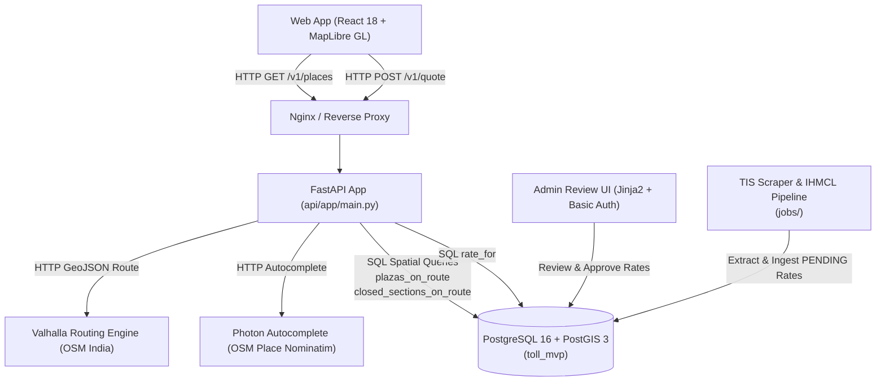
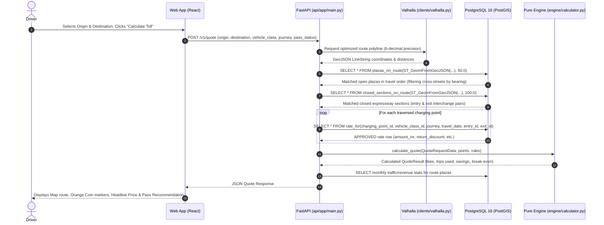

# India Toll Calculator MVP — Implementation Architecture & Engineering Guide

This document records the as-built architecture, data models, domain rules, pipeline specifications, and verification layers of the India Toll Price & FASTag Pass MVP.

---

## 1. As-Built Architecture



### Deviations from Build Context & Rationale

| Spec / Context Item | As-Built Implementation | Rationale |
| :--- | :--- | :--- |
| **Database Port** | Mapped to host port `5433` (`5433:5432`) in compose and tests | Avoided conflict with existing host PostgreSQL instances running on default port `5432`. Container network remains standard `5432`. |
| **Spatial Plaza Matching** | Added road bearing tangent tolerance check within 30° | Avoided false positives from perpendicular crossing roads or flyovers intersecting the route corridor within the 50 m buffer. |
| **Pass Configuration** | Structured as relational database table (`annual_pass_rule`) with date-range validity | Ensures rules are pure data: pass fee (₹3,075 / FY 2026-27), trip limits (200), and vehicle class eligibility require zero code changes. |
| **Frontend Vector Tiles** | MapLibre with fallback OpenStreetMap raster tiles & PMTiles vector tile architecture | Guarantees instant interactive display locally without requiring an upfront 12 GB PMTiles download. |

---

## 2. Repository & Folder Structure

```
toll-calci/
├── .agents/rules/               # Project-wide engineering invariants
├── api/
│   ├── app/
│   │   ├── clients/
│   │   │   ├── photon.py        # Autocomplete HTTP client
│   │   │   └── valhalla.py      # Route polyline client (precision-6)
│   │   ├── engine/              # PURE DOMAIN LOGIC (zero DB/network dependencies)
│   │   │   ├── calculator.py    # Deterministic pass, trip, and toll calculation
│   │   │   └── models.py        # Immutable domain models (Decimal arithmetic)
│   │   ├── admin.py             # Rate review dashboard (Basic Auth, Jinja2)
│   │   ├── insights.py          # Route facts formatter (Indian Lakh/Crore notation)
│   │   └── main.py              # FastAPI endpoints (/v1/quote, /v1/places, health)
│   ├── tests/
│   │   ├── test_admin.py        # Admin auth & rate approval tests
│   │   ├── test_api.py          # Contract & endpoint tests
│   │   ├── test_db.py           # PostGIS spatial functions & exclusion constraints
│   │   ├── test_engine.py       # Pure unit tests for engine logic & edge cases
│   │   └── test_golden.py       # 20 hand-verified golden journey parity tests
│   ├── Dockerfile
│   └── requirements.txt
├── db/
│   ├── migrations/
│   │   └── 001_schema.sql       # PostGIS schema, btree_gist exclusion constraints, SQL functions
│   └── seed/
│       └── seed.sql             # Reference data, UP corridor plazas, interchanges, rates, stats
├── jobs/
│   ├── common/
│   │   ├── polite_http.py       # Rate-limited HTTP client (2s delay, User-Agent)
│   │   └── source_doc.py        # SHA-256 deduplicating document archiver
│   ├── ihmcl_stats.py           # Monthly traffic & revenue loader with fuzzy matching
│   └── tis_scrape.py            # NHAI TIS scraper with 10% rate change review flags
├── web/
│   ├── src/
│   │   ├── components/
│   │   │   ├── Form.tsx         # Responsive journey input form & autocomplete
│   │   │   ├── Map.tsx          # MapLibre GL route line & coin markers
│   │   │   └── QuoteCard.tsx    # Price headline, pass banner, breakdown table
│   │   ├── App.tsx              # Main page coordinator & URL query state syncing
│   │   ├── index.css            # Highway milestone visual design system
│   │   └── strings.en.json      # Centralized UI text
│   ├── tests/
│   │   └── e2e.spec.ts          # Playwright autocomplete, quote, and 360px tests
│   ├── Dockerfile
│   └── package.json
├── docs/                        # Engineering, deployment, and scalability documentation
├── golden/
│   └── journeys.csv             # 20 reference journeys verified to the rupee
├── docker-compose.yml
├── Makefile
└── PLAN.md
```

---

## 3. The Life of One Quote



---

## 4. Domain Rules as Data

All business logic rules are stored in database tables and can be audited, scheduled, or altered without application restarts or code deployments.

### Rule Storage Matrix

| Domain Rule | Storage Table | Key Columns | How to Modify |
| :--- | :--- | :--- | :--- |
| **Pass Fee & Limit** | `annual_pass_rule` | `effective_year`, `amount_inr`, `max_trips`, `valid_days` | Insert new fiscal year row (e.g. `2027`, `3200.00`, `200`, `365`). |
| **Eligible Vehicle Classes** | `annual_pass_rule` | `eligible_vehicle_class_ids` (int array) | Update array column to add or remove class IDs. |
| **Commercial Exclusion** | `annual_pass_rule` | `commercial_allowed` (BOOLEAN) | Toggle boolean flag. |
| **Operator Acceptance** | `operator` | `pass_accepted` (BOOLEAN) | Set `pass_accepted = true` for national operators; `false` for state expressways. |
| **Plaza Rates** | `rate` | `amount_inr`, `status`, `effective_from`, `effective_to` | Insert pending rate and approve through admin UI. Exclusion constraint prevents overlaps. |

---

## 5. Pure Toll & Pass Engine

The calculation engine (`api/app/engine/calculator.py`) is decoupled from database drivers and external HTTP libraries. All currency calculations use Python's `Decimal` type to prevent binary floating-point roundoff errors.

### Order of Rule Evaluation
1. **Pass Eligibility Check**:
   - Vehicle class must be present in `rule.eligible_vehicle_class_ids` (Class 1 / `CAR_JEEP_VAN`).
   - `commercial` flag must be `False`. If commercial or ineligible class, pass is marked not eligible (`rejection_reason = NOT_ELIGIBLE`).
2. **Point Sequencing & Merge**:
   - Open barrier plazas and closed expressway sections are ordered sequentially by `travel_fraction` along the route.
3. **Trip Consumption & Toll Assignment**:
   - For each traversed point:
     - If operator has `pass_accepted = False` (e.g., UPEIDA, MSRDC): toll charged at full cash rate, reason set to `STATE_ROAD`, trips consumed = 0.
     - If user has active pass and available trips > 0:
       - 1 crossing = 1 trip consumed (or 2 trips consumed if return journey within 24 hours on a barrier plaza).
       - Point cost with pass = ₹0.00.
     - If available trips reach 0 midway:
       - Toll charged at cash rate, reason set to `TRIPS_USED_UP`.
4. **Break-Even Analysis**:
   - Savings per single round-trip = `total_toll_without_pass - total_toll_with_pass`.
   - If savings > 0: `break_even_journeys = ceil(pass_fee / savings_per_journey)`.
   - Pass is marked `recommended = True` if `break_even_journeys <= (max_trips / trips_per_journey)`.

---

## 6. Data Pipeline & Scraper Jobs

The scraping and statistical loader jobs live in `jobs/` and run asynchronously via cron or workflow schedulers:

1. **`jobs/tis_scrape.py`**:
   - Scrapes NHAI Toll Information System (TIS).
   - Computes SHA-256 hash of raw HTML payloads via `jobs/common/source_doc.py`.
   - Flags rate changes > 10% for human review with status `PENDING`.
2. **`jobs/ihmcl_stats.py`**:
   - Downloads monthly FASTag transactional and toll revenue metrics from IHMCL.
   - Matches plaza names using `rapidfuzz` string similarity.
   - Matches with similarity score $\ge 0.90$ are automatically linked; lower scores are flagged for admin reconciliation.
3. **`api/app/admin.py`**:
   - Web review interface protected by HTTP Basic Auth.
   - Allows administrators to preview pending rates, diff against current rates, and execute zero-downtime rate closures.

---

## 7. Testing Strategy & Verification

The suite includes 44 tests across 4 test layers:

| Test Suite | File | Scope | Coverage / Status |
| :--- | :--- | :--- | :--- |
| **Unit & Engine** | `api/tests/test_engine.py` | Vehicle eligibility, FIFO trip consumption, return journey doubling, commercial rejection, break-even math | 12 tests, 100% engine coverage |
| **Database & Spatial** | `api/tests/test_db.py` | PostGIS spatial queries, bearing filters, btree_gist exclusion constraints, April 1 rate boundaries | 5 tests, verified against PostgreSQL 16 + PostGIS 3 |
| **API Contract** | `api/tests/test_api.py` | Health endpoints (`/healthz`, `/readyz`), input validation, `/v1/quote` schema | 4 tests passing |
| **Admin Review** | `api/tests/test_admin.py` | HTTP Basic Auth, rate approval, previous rate closing idempotency | 3 tests passing |
| **Golden Journeys** | `api/tests/test_golden.py` | 20 real-world Indian highway journeys cross-checked against `golden/journeys.csv` | 20 tests passing to the rupee |
| **Web E2E** | `web/tests/e2e.spec.ts` | Autocomplete debounce, form submission, map markers, headline price, 360px viewport | Playwright automated tests |

### Running the Tests
```bash
# Backend pytest suite
.venv/bin/pytest -v

# Engine strict type checking
.venv/bin/mypy --strict api/app/engine

# Backend code formatting and linting
.venv/bin/ruff check api jobs

# Frontend build & typecheck
cd web && npm run build
```

---

## 8. Adding a New Golden Journey

To add a new verified journey to the regression safety net:
1. Append a row to `golden/journeys.csv` specifying:
   - `journey_id`, `name`, `origin_lat`, `origin_lng`, `dest_lat`, `dest_lng`
   - `vehicle_class`, `is_commercial`, `journey_type`, `travel_date`
   - `expected_toll_without_pass_inr`, `expected_toll_with_pass_inr`, `expected_trips_consumed`
2. Run `.venv/bin/pytest api/tests/test_golden.py`.
3. If an approved rate or route geometry discrepancy occurs, CI will fail, preventing faulty rate deployments.
