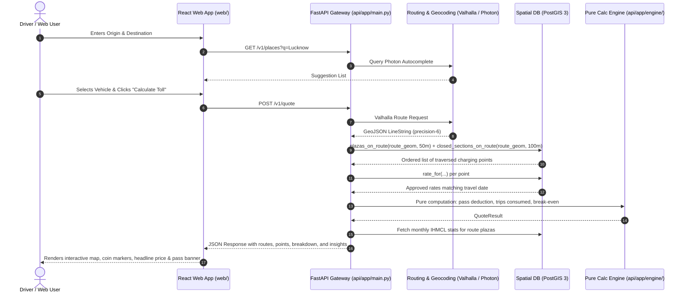

# India Toll Price & FASTag Pass MVP — Project Overview & Skeleton Details

This document provides a concise overview of the project vision, core design invariants, architectural skeleton, module decomposition, and operational interfaces.

For full developer quickstart and setup instructions, see the root [README.md](file:///Users/darkhorse/Projects/toll-calci/README.md).

---

## 1. Executive Summary

The **India Toll Price & FASTag Pass MVP** is an independent, open-source calculation platform built specifically for Indian highways and expressways.

### Key Capabilities
- **Exact Road Tolls**: Eliminates toll ambiguity by querying only officially approved tariff notifications (`status = 'APPROVED'`). Never estimates or hallucinates tolls.
- **Annual FASTag Pass Optimization**: Evaluates the official FY 2026-27 FASTag Annual Pass (₹3,075 / 200 trips), enforcing non-commercial vehicle eligibility, operator pass acceptance, and calculating exact break-even round-trips.
- **Hybrid Highway Routing**: Accurately handles mixed journeys containing national highways (NHAI/MoRTH barrier plazas) and state-operated closed expressways (UPEIDA, MSRDC, YEIDA interchange pairs with ticketed entry/exit).
- **Public Traffic & Revenue Insights**: Surfaces monthly plaza traffic volumes and toll collections formatted in Indian notation (*lakhs* and *crores*) based on IHMCL FASTag reports.
- **Strict User Privacy**: Clamps GPS coordinates to 2 decimal places in server logs. Operates completely without user accounts, cookies, or tracking pixels.

---

## 2. Core Design Invariants

```
┌─────────────────────────────────────────────────────────────────────────────┐
│                            CORE INVARIANTS                                  │
├─────────────────────────────────────────────────────────────────────────────┤
│ 1. Rules as Data: Pass fee, trip limits, vehicle classes, and operator      │
│    acceptance live in database tables, not hardcoded in application logic.  │
│ 2. Floating-Point Safety: Python `Decimal` arithmetic throughout the engine │
│    with whole-rupee rounding only on API serialization.                     │
│ 3. Deterministic FIFO Trip Accounting: 1 crossing = 1 trip consumed        │
│    (2 trips for 24h return). Trips exhausted midway fall back to cash.      │
│ 4. No Overlapping Rates: PostgreSQL `btree_gist` exclusion constraint       │
│    guarantees exactly one approved rate per charging point at any timestamp.│
│ 5. Spatial Tangent Check: Spatial function compares road bearing against    │
│    route tangent within 30° to reject perpendicular cross streets.          │
│ 6. 100% Free Stack: Powered by Valhalla, Photon, MapLibre GL, and OSM.      │
└─────────────────────────────────────────────────────────────────────────────┘
```

---

## 3. High-Level Skeleton & Data Flow



---

## 4. Module & File Responsibility Matrix

| Subsystem | Key Files | Primary Responsibilities |
| :--- | :--- | :--- |
| **Database Schema** | `db/migrations/001_schema.sql` | PostGIS spatial tables (`charging_point`, `interchange`, `rate`, `annual_pass_rule`), exclusion constraint `no_overlapping_approved_rates`, and SQL functions `plazas_on_route`, `closed_sections_on_route`, `rate_for`. |
| **Reference Seed** | `db/seed/seed.sql` | Real-world UP corridor coordinates (NH-27 Nawabganj, Barajod, cross-street plaza, Agra-Lucknow expressway interchanges 301-303), FY 2025/2026 rates, IHMCL stats. |
| **Pure Engine** | `api/app/engine/calculator.py`<br/>`api/app/engine/models.py` | Isolated, deterministic Python business logic. Zero dependencies on external networks or databases. Type-checked with `mypy --strict`. |
| **API Application** | `api/app/main.py`<br/>`api/app/insights.py`<br/>`api/app/admin.py` | FastAPI web app with JSON quote logging, route facts formatting, and Jinja2 admin review interface with Basic Auth. |
| **Data Pipelines** | `jobs/tis_scrape.py`<br/>`jobs/ihmcl_stats.py`<br/>`jobs/common/` | Automated ingestion pipelines with SHA-256 deduplication, polite rate limiting, and 10% rate change review flags. |
| **Web Frontend** | `web/src/App.tsx`<br/>`web/src/components/Form.tsx`<br/>`web/src/components/Map.tsx`<br/>`web/src/components/QuoteCard.tsx` | Single page application with highway milestone aesthetic, MapLibre GL map, coin markers, and URL query state persistence. |
| **Testing Suites** | `api/tests/test_*.py`<br/>`golden/journeys.csv`<br/>`web/tests/e2e.spec.ts` | 47 backend tests (unit, database, API contract, golden journeys to the rupee) + Playwright end-to-end tests for desktop & 360px mobile viewports. |
| **Documentation** | `docs/IMPLEMENTATION.md`<br/>`docs/DEPLOYMENT.md`<br/>`docs/SCALABILITY.md` | Architectural deep-dive, single-server 16GB Indian cloud deployment runbook, April 1 rate revision checklist, and horizontal scaling roadmap. |

---

## 5. Summary of Architecture Decisions (from DECISIONS.md)

- **ADR 001 — Database Host Port**: Mapped container port 5432 to host port 5433 to avoid local machine port collision.
- **ADR 002 — Spatial Plaza Road Bearing Tolerance**: Incorporated a 30° tangent azimuth check in `plazas_on_route` to reject perpendicular cross streets intersecting the route corridor within the 50 m buffer.
- **ADR 003 — Pass Configuration as Database Data**: Stored annual pass price, 200-trip limits, and eligible vehicle classes in the `annual_pass_rule` table with date range validity.
- **ADR 004 — Vector Map Delivery with Fallback**: MapLibre GL uses vector tiles with automated raster tile fallback to ensure instant local developer display without requiring an upfront 12 GB download.
